```{=html}
<div class="post-body">
<div class="blindtest-body">
<p>Do the lines and circles intersect? Which letter is circled in red? How many circles and squares are in the image? <a href="https://vlmsareblind.github.io/">BlindTest Benchmark</a> turns these questions, which humans can answer with ease, into an evaluation set for VLMs. Even Sonnet-3.5 achieves an average score of only 77.84, still some distance from a human score of 100.</p>
<p>Today I am sharing a paper first released in July 2024: <a href="https://vlmsareblind.github.io/">Vision language models are blind: Failing to translate detailed visual features into words</a>.</p>
<figure><h4 class="fig-title">Seven visual perception tasks</h4><a class="article-image image-preview--result" style="--image-width:1586px;--image-ratio:2.208913649" href="/assets/blindtest/figure-01.png" data-image-viewer data-pswp-width="1586" data-pswp-height="718" aria-haspopup="dialog" aria-label="Enlarge image: BlindTest figure 1">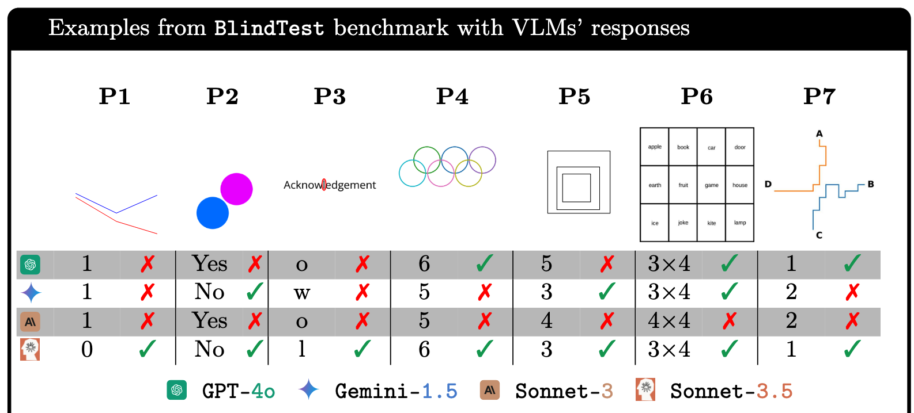</a><figcaption>Examples are paired with answers from four vision-language models.</figcaption></figure>
<section aria-label="TL;DR" class="tldr"><b>TL;DR</b><p>This paper introduces BlindTest, a benchmark of seven basic visual tasks. It finds that the leading VLMs of the time frequently fail at counting shapes, judging intersections, and identifying circled letters. The best-performing model, Claude 3.5 Sonnet, reaches an average accuracy of just 77.84%. Errors are particularly common when shapes overlap or sit close together; increasing the spacing substantially improves performance. On two geometric tasks, linear probes can extract correct answers from the visual features of the tested open-source models, showing that relevant information has been encoded but is not successfully translated into correct language answers.</p></section>
<p>This blog contains two parts: 1. My notes and questions while reading the paper. 2. A follow-up: this work is now more than two years old, and current VLMs have moved far beyond the state of the art at the time. How do today's models perform? Do the paper's conclusions still hold? What have the authors worked on since? (This line of work appears to be driven mainly by <a href="https://taesiri.ai/">Mohammad Reza Taesiri</a> at the University of Alberta, including GlitchBench from December 2023 and VLMBIAS BENCHMARK from May 2025.)</p>
<p>I think the most valuable aspect of this work is its exclusive use of synthetic data, which makes it possible to run controlled ablations across many dimensions and variables, including the colors and counts discussed below. This is difficult to do with natural-image datasets. Its potential weakness also lies in the synthetic dataset. Programmatically generated examples naturally have the characteristics of toy images and out-of-distribution data. Perhaps this is why the benchmark currently seems useful mainly as a probe, without really explaining the phenomenon or leading to targeted methods that improve model performance.</p>
<h2>1 Introduction</h2>
<p>The authors begin by noting that, although frontier models such as GPT-4V are advancing rapidly, existing VLM benchmarks still have many problems. For example, 42.9% of questions in MMMU can be answered without looking at an image (<a href="https://arxiv.org/abs/2403.20330">Are We on the Right Way for Evaluating Large Vision-Language Models?</a>). Answers may follow from textual reasoning or may already have been encoded in model weights during pretraining, making the image unnecessary. This makes testing visual ability itself, while excluding the effects of language, reasoning, and world knowledge, an important part of VLM evaluation. This is what the paper means by asking models to solve low-level vision tasks: testing the atomic abilities of perception.</p>
<p>Inspired by human vision tests, the authors introduce BlindTest, a benchmark covering seven types of basic perception task. (Why not use existing human eye tests? First, there is a risk of test-set leakage. Second, the authors evaluated GPT-4o on human vision tests and found that these tests were already saturated for the leading VLMs of the time.)</p>
<p>The authors expect VLMs to perform poorly on this benchmark. Their motivation is that these models process image inputs through late fusion (<a href="https://arxiv.org/abs/2304.08485">Visual Instruction Tuning</a>): image encoding takes place without involving the textual question. The encoder therefore does not focus on the question's particular requirements, instead operating on the average prior learned during pretraining. Meanwhile, the sizes, positions, and other properties of geometric elements in BlindTest are features particular to the visual modality that are difficult to describe in language. Images consisting purely of simple geometric shapes on a white background are also uncommon in vision-encoder training data, making them an OOD distribution. The information our questions care about may therefore be difficult for the vision encoder to capture. (This brings us back to image–text alignment. Can the two modalities be aligned without loss? How should that alignment be measured? This explanation also seems to attribute VLM failures to the encoder, whereas the paper later argues that the encoder already provides enough information. How should we understand that tension?)</p>
<p>With this motivation, the paper constructs a seven-task visual check-up and evaluates the then-leading models: GPT-4o, Gemini-1.5 Pro, Claude-3 Sonnet, and Claude-3.5 Sonnet.</p>
<p>The findings are:</p>
<ol>
<li>Even VLMs that perform well on contemporary chart benchmarks cannot reliably distinguish whether two lines or circles intersect, especially when the shapes are close together. (Are VLMs nearsighted?)</li>
<li>VLMs recognize circles and words, but struggle to identify the letter circled within a word.</li>
<li>VLMs are good at counting separate circles, but perform poorly on intersecting or overlapping shapes, including circles and polygons.</li>
<li>VLMs struggle to count rows and columns in a grid. This sits uneasily with their strong performance on DocVQA, where accuracy exceeds 90%.</li>
<li>VLMs struggle to count paths between two points in images resembling subway maps.</li>
<li>GPT-4o outperforms Gemini-1.5 Pro on seven other VLM benchmarks, but performs worse on BlindTest. Even the leading large models score below 80% accuracy.</li>
<li>Chain-of-thought models show no significant improvement over ordinary models. Test-time scaling therefore appears to offer little benefit on BlindTest. (Does this still hold? For example, how would GPT-6-Luna score with low versus high reasoning effort? Has the benchmark already saturated?)</li>
<li>VLMs perform substantially better on simplified versions of BlindTest.</li>
<li>Linear probes suggest that the vision encoder already contains all the information required to solve the tasks, locating the problem in the subsequent language-output stage. (Do the method and conclusion still apply to today's leading models?)</li>
</ol>
<h2>2 Experiments</h2>
<p>Here is the overall results table.</p>
<figure><h4 class="fig-title">Accuracy across BlindTest tasks</h4><a class="article-image image-preview--wide" style="--image-width:1426px;--image-ratio:2.752895753" href="/assets/blindtest/figure-02.png" data-image-viewer data-pswp-width="1426" data-pswp-height="518" aria-haspopup="dialog" aria-label="Enlarge image: BlindTest figure 2">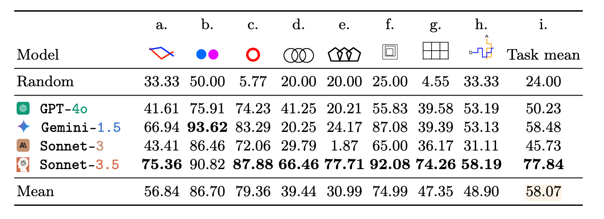</a><figcaption>The table compares model accuracy with a random baseline across the benchmark.</figcaption></figure>
<p>Sonnet-3.5 is actually doing fairly well, although it still cannot achieve 100% accuracy on these easy cases.</p>
<p>The paper evaluates the following models:</p>
<p>Four closed-source state-of-the-art models: GPT-4o, Gemini-1.5 Pro, Claude-3 Sonnet, and Claude-3.5. They perform best on seven other VLM benchmarks: MMMU, AI2D, Math-Vista, ChartQA, DocVQA, ActivityNet-QA, and EgoSchema. The authors stopped testing Claude 3 Opus partway through.</p>
<p>Eight open-source models of different sizes from three families: LLaVA OneVision-qwen2, Phi-3.5-vision-instruct, and InternVL-2.</p>
<p>Two slow-thinking models, Gemini 2.0 Flash-Thinking and QVQ-Preview, are included for completeness. Their performance shows no significant improvement over non-thinking models.</p>
<p>There are seven tasks. Below are their descriptions and results.</p>
<h3>Task 1: Counting intersections between line plots</h3>
<p>Each of two line plots consists of two connected segments. The plots can intersect at 0, 1, or 2 points, and the VLM must report the number of intersections.</p>
<p>There are 1,800 images and 3,600 question–answer pairs. Images are square, with side lengths of 384, 768, or 1,152 pixels. For each plot, the three x-coordinates are fixed at the left edge, center, and right edge, while y-coordinates are randomly sampled from a predefined 12 × 12 grid. Line width is also randomly sampled as a variable.</p>
<figure><h4 class="fig-title">Line intersections</h4><a class="article-image image-preview--montage" style="--image-width:2908px;--image-ratio:1.000000000" href="/assets/blindtest/figure-03.png" data-image-viewer data-pswp-width="2908" data-pswp-height="2908" aria-haspopup="dialog" aria-label="Enlarge image: BlindTest figure 3">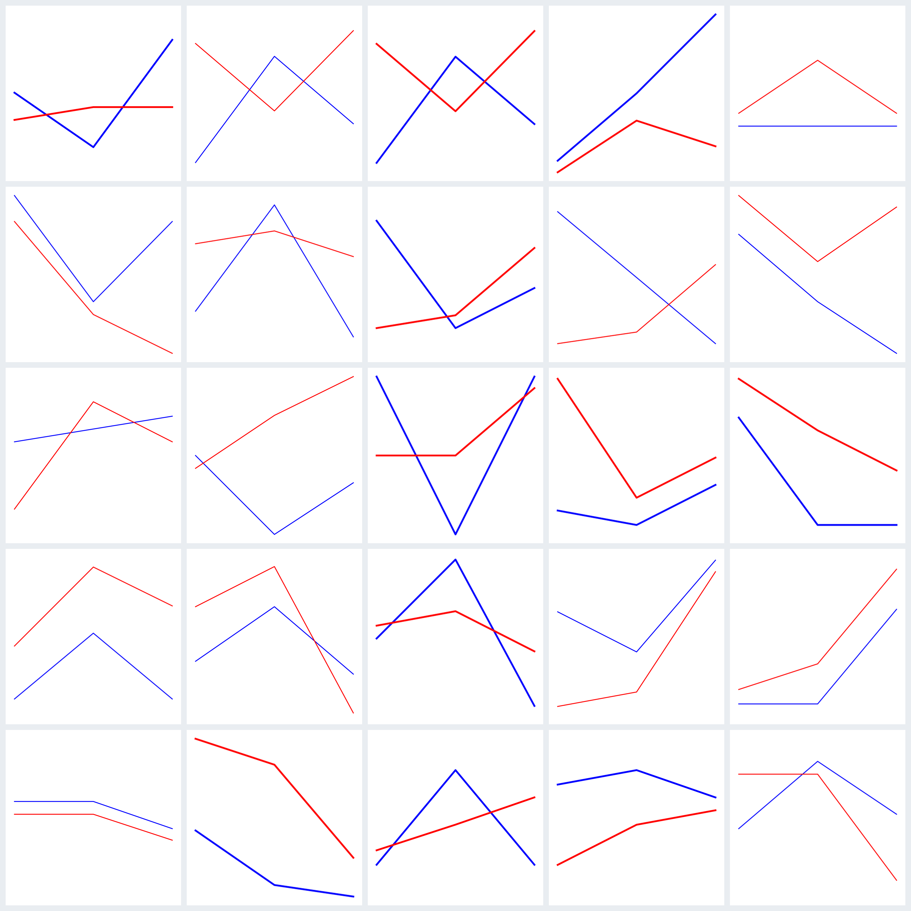</a><figcaption>Examples contain zero, one, or two crossings between two polylines.</figcaption></figure>
<figure><h4 class="fig-title">Line width and point separation</h4><a class="article-image image-preview--result" style="--image-width:1460px;--image-ratio:2.085714286" href="/assets/blindtest/figure-04.png" data-image-viewer data-pswp-width="1460" data-pswp-height="700" aria-haspopup="dialog" aria-label="Enlarge image: BlindTest figure 4">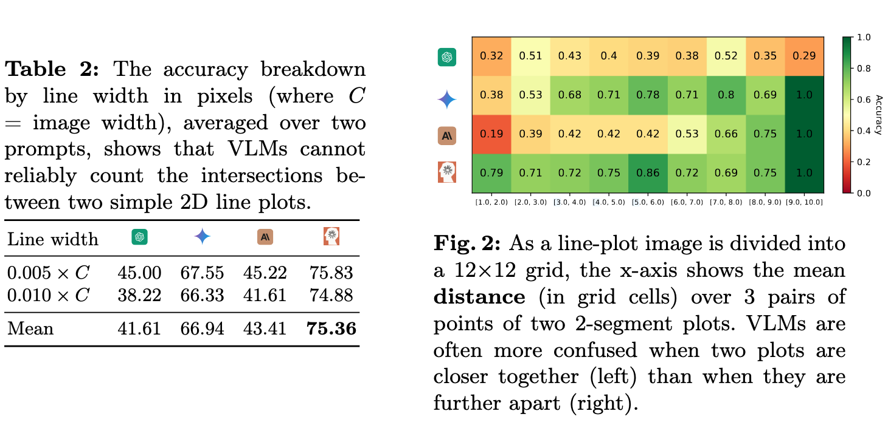</a><figcaption>The table varies stroke width. The heatmap groups outcomes by the separation of the plots’ points.</figcaption></figure>
<p>The table on the left varies line width. Thicker lines actually cause a small, general decline in accuracy, which is rather counterintuitive. The heatmap on the right varies whether the two plots are close together or far apart. Apart from GPT being generally poor and Sonnet 3.5 generally good, the other models tend to do better when the plots are farther apart. This makes sense: two nearby lines are harder to distinguish and judge for intersections, while widely separated lines are easier. In the group with the largest separation, three of the four models reach 100% accuracy.</p>
<p>The models' generally poor performance also contrasts with their strong ChartQA results. Perhaps ChartQA is less about vision than it appears, and tests reasoning and other abilities more heavily.</p>
<p>Next are the ablations on image size and intersection count. On the left, the models' accuracy barely changes across image sizes, suggesting little sensitivity to resolution. On the right, however, the true number of intersections clearly affects accuracy. Could this reflect answer preferences? For example, Sonnet seems inclined to assume that the plots always intersect, while GPT tends to answer either 0 or 2.</p>
<figure><h4 class="fig-title">Intersection-count ablations</h4><a class="article-image image-preview--result" style="--image-width:1320px;--image-ratio:2.142857143" href="/assets/blindtest/figure-05.png" data-image-viewer data-pswp-width="1320" data-pswp-height="616" aria-haspopup="dialog" aria-label="Enlarge image: BlindTest figure 5">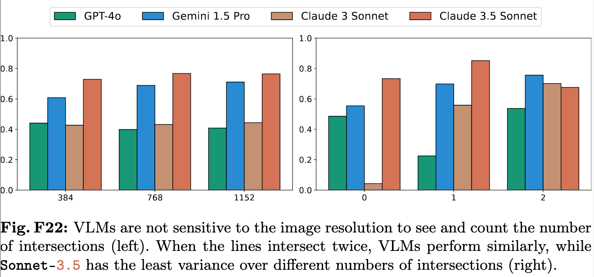</a><figcaption>Accuracy is grouped by image resolution on the left and by the true number of intersections on the right.</figcaption></figure>
<h3>Task 2: Do the two circles intersect or overlap?</h3>
<p>Given two solid circles of equal size, the VLM must judge whether they overlap or touch.</p>
<p>There are 672 images and 1,344 question–answer pairs, generated with different radii, center distances, and relative positions. (The count in the body of arXiv v6 is incorrect here; I use the actual count in the released HF dataset.)</p>
<figure><h4 class="fig-title">Circle overlap</h4><a class="article-image image-preview--montage" style="--image-width:2908px;--image-ratio:1.000000000" href="/assets/blindtest/figure-06.png" data-image-viewer data-pswp-width="2908" data-pswp-height="2908" aria-haspopup="dialog" aria-label="Enlarge image: BlindTest figure 6">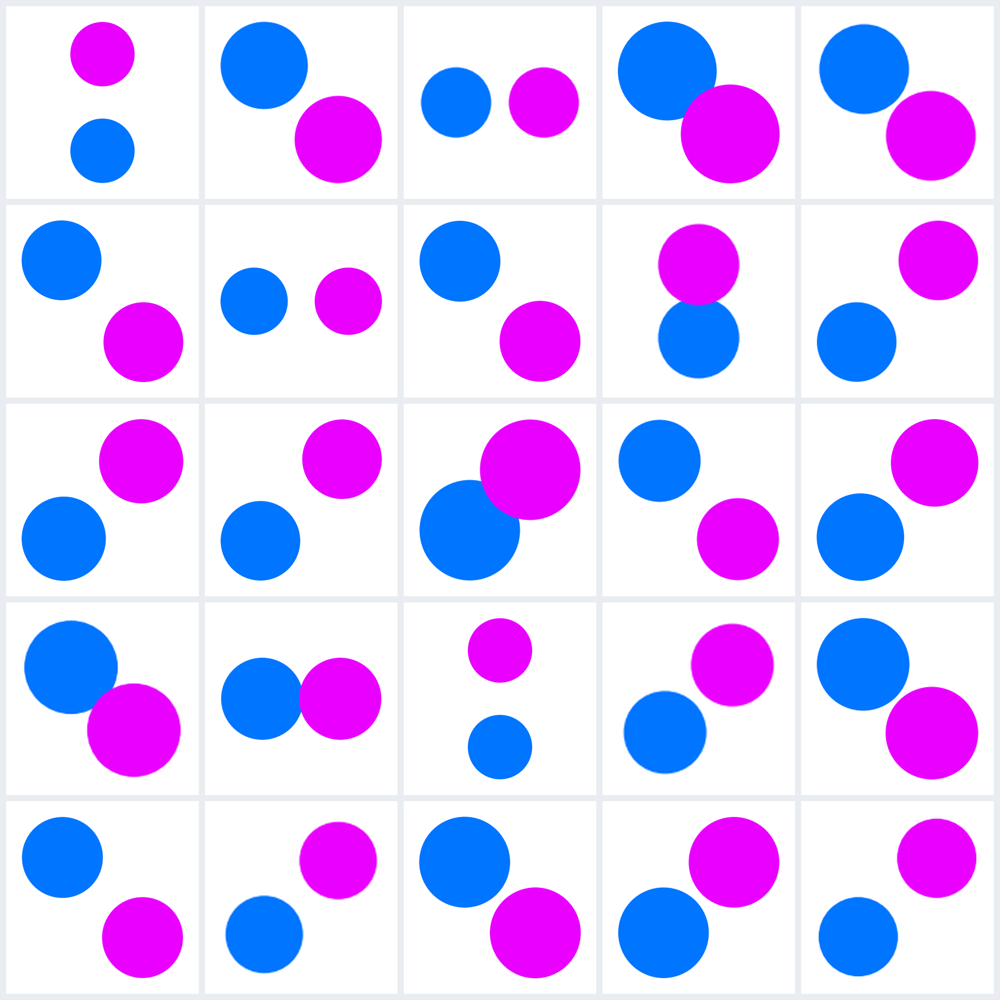</a><figcaption>The generated examples vary the radius, separation, and placement of two circles.</figcaption></figure>
<figure><h4 class="fig-title">Overlapping and touching circles</h4><a class="article-image image-preview--result" style="--image-width:1478px;--image-ratio:2.820610687" href="/assets/blindtest/figure-07.png" data-image-viewer data-pswp-width="1478" data-pswp-height="524" aria-haspopup="dialog" aria-label="Enlarge image: BlindTest figure 7">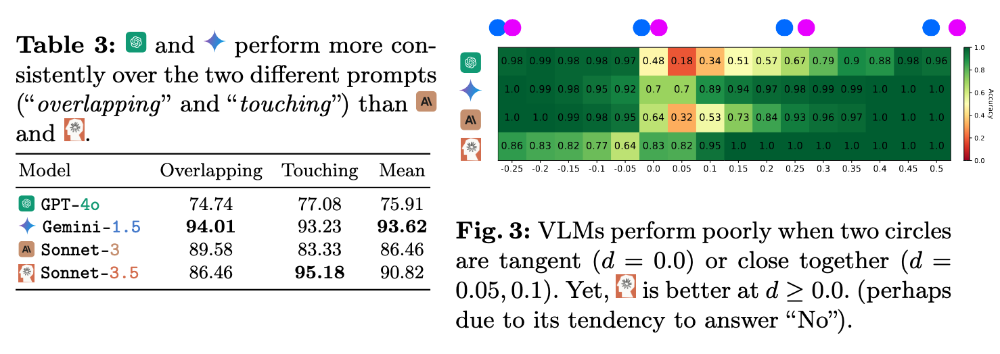</a><figcaption>The table separates the answer types. The heatmap groups results by circle geometry.</figcaption></figure>
<p>The table on the left varies the question or prompt. There is no obvious pattern: asking about “overlapping” or “touching” produces no consistent increase or decrease in accuracy. The heatmap on the right varies circle distance, revealing V-shaped curves that first decline and then recover. Sonnet 3.5's low point is clearly shifted to the left. This may relate to its tendency to answer “not overlapping/not intersecting,” which also gives it high accuracy when the circles are far apart. GPT performs particularly poorly at the bottom of the curve, suggesting weakness in distinguishing fine details.</p>
<p>(The authors introduce a late-fusion explanation here and suggest that the encoder could be responsible. Yet this seems at odds with the later linear-probe section, which leans toward the conclusion that enough information is already available.)</p>
<p>Next are image-size and orientation ablations. Each model has its own highs and lows, without an obvious common pattern. (I have seen similar cliffs and fluctuations with image size and orientation in my own experiments. This seems to be a complicated issue, possibly related to each model's architecture, rather than a clear shared preference.)</p>
<figure><h4 class="fig-title">Circle overlap by resolution and orientation</h4><a class="article-image image-preview--result" style="--image-width:918px;--image-ratio:1.657039711" href="/assets/blindtest/figure-08.png" data-image-viewer data-pswp-width="918" data-pswp-height="554" aria-haspopup="dialog" aria-label="Enlarge image: BlindTest figure 8">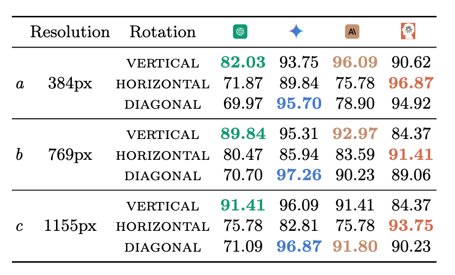</a><figcaption>Rows compare vertical, horizontal, and diagonal arrangements at three image sizes.</figcaption></figure>
<p>The paper also compares colors, again without an obvious pattern. (Dark gray plus light gray performs better than magenta plus blue. We would normally expect a high-contrast red-and-blue combination to be easier to distinguish. This reminds me of experiments in which I varied target versus background colors to test the effect of contrast on accuracy. Combinations that looked less distinct to human eyes, such as white plus pale beige, sometimes scored higher than black plus white. That was quite unexpected.)</p>
<figure><h4 class="fig-title">Circle color ablation</h4><a class="article-image image-preview--result" style="--image-width:694px;--image-ratio:2.282894737" href="/assets/blindtest/figure-09.png" data-image-viewer data-pswp-width="694" data-pswp-height="304" aria-haspopup="dialog" aria-label="Enlarge image: BlindTest figure 9">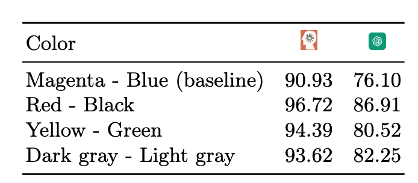</a><figcaption>The table compares four color pairs for the overlap task.</figcaption></figure>
<h3>Task 3: Identifying the circled letter in a word</h3>
<p>The VLM must identify the letter enclosed by a red circle in an English word.</p>
<p>There are 52 × 3 × 2 = 312 images and 624 question–answer pairs. The paper uses three English words, three red-circle widths, and two fonts, circling each of the 15, 17, and 20 letters in the three words in turn. (Again, the sample count in the main text is incorrect.)</p>
<figure><h4 class="fig-title">Letters marked by a circle</h4><a class="article-image image-preview--wide" style="--image-width:2908px;--image-ratio:2.884920635" href="/assets/blindtest/figure-10.png" data-image-viewer data-pswp-width="2908" data-pswp-height="1008" aria-haspopup="dialog" aria-label="Enlarge image: BlindTest figure 10">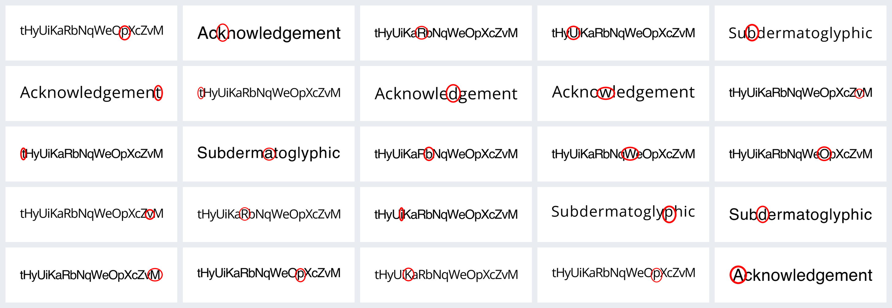</a><figcaption>A red circle identifies the target letter in each word or character string.</figcaption></figure>
<p>For familiar words, models are better at identifying the right letter. On Acknowledgement, all models except GPT perform better.</p>
<figure><h4 class="fig-title">Long letter strings</h4><a class="article-image image-preview--wide" style="--image-width:1368px;--image-ratio:3.181395349" href="/assets/blindtest/figure-11.png" data-image-viewer data-pswp-width="1368" data-pswp-height="430" aria-haspopup="dialog" aria-label="Enlarge image: BlindTest figure 11">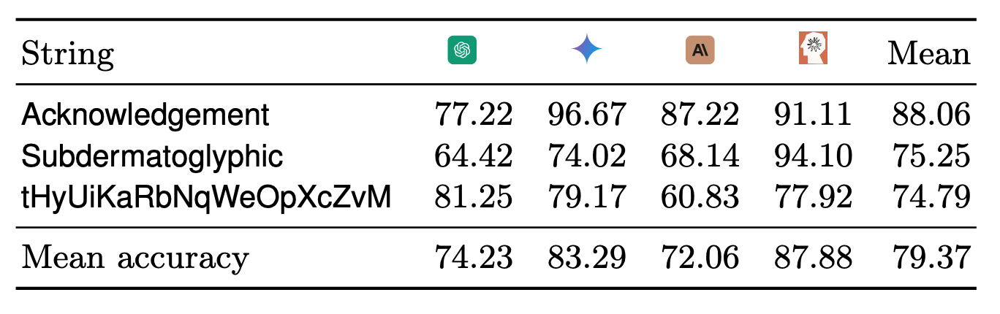</a><figcaption>Accuracy is reported for each model and string.</figcaption></figure>
<p>Models also do noticeably better on shorter words without repeated letters. Could this be because those words occur frequently in the pretraining data?</p>
<figure><h4 class="fig-title">Short familiar words</h4><a class="article-image image-preview--result" style="--image-width:832px;--image-ratio:2.166666667" href="/assets/blindtest/figure-12.png" data-image-viewer data-pswp-width="832" data-pswp-height="384" aria-haspopup="dialog" aria-label="Enlarge image: BlindTest figure 12">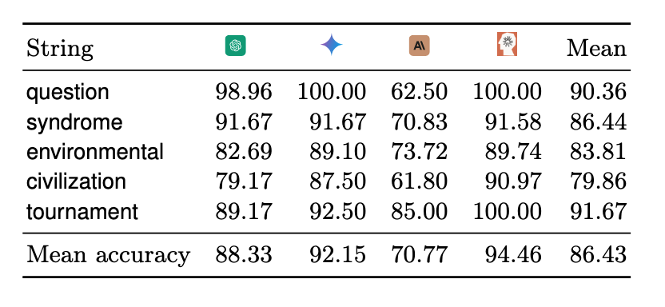</a><figcaption>Accuracy is reported separately for each word.</figcaption></figure>
<h3>Task 4: Counting Olympic-style rings</h3>
<p>The VLM must count the shapes in an image of multiple interlocking circles arranged like an Olympic logo.</p>
<p>There are 480 images and 960 question–answer pairs, spanning different image sizes, shape counts, radii, line widths, and colors. The authors also flip images and replace circles with pentagons.</p>
<figure><h4 class="fig-title">Counting interlocking rings</h4><a class="article-image image-preview--montage" style="--image-width:2908px;--image-ratio:1.000000000" href="/assets/blindtest/figure-13.png" data-image-viewer data-pswp-width="2908" data-pswp-height="2908" aria-haspopup="dialog" aria-label="Enlarge image: BlindTest figure 13">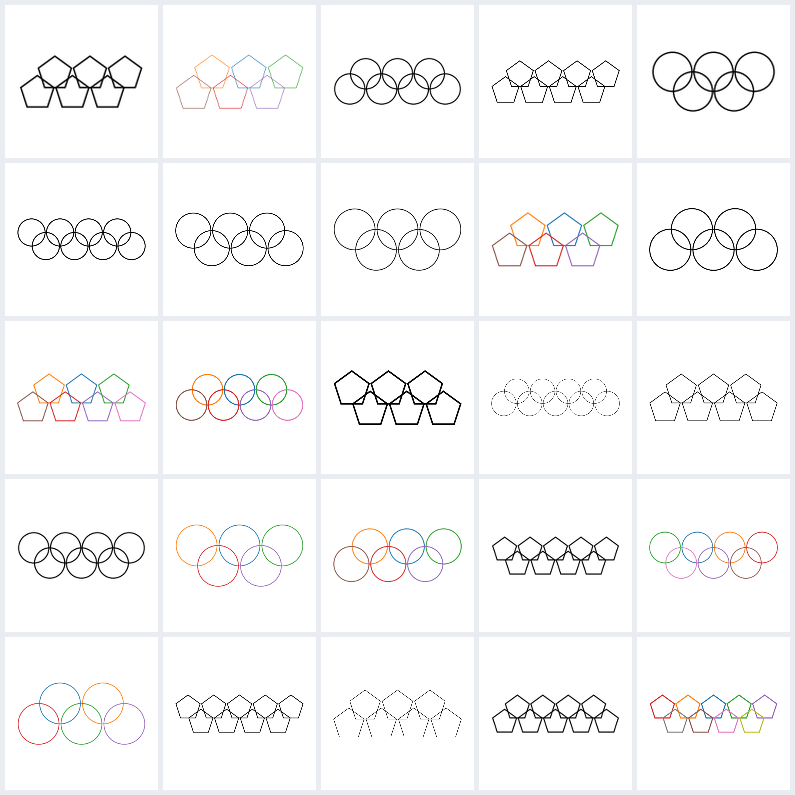</a><figcaption>The examples vary shape count, arrangement, stroke, and color.</figcaption></figure>
<p>The following experiments vary resolution, color, and ground-truth count. The paper argues that resolution and color have little effect, but I see a clear drop for Sonnet 3.5 at resolution 384. This resembles something I have observed before: changing the resolution of the same image can produce abrupt, non-smooth performance changes. For example, performance at resolution 200 can be substantially worse than at both 100 and 300.</p>
<p>The results become more extreme across shapes and configurations. VLMs do very well on the familiar five-circle arrangement, while other shape-and-count combinations yield mixed results. This looks like a clear VLM bias. (It is no surprise that the authors later wrote a paper on bias.)</p>
<figure><h4 class="fig-title">Circle and pentagon counts</h4><a class="article-image image-preview--result" style="--image-width:1410px;--image-ratio:1.243386243" href="/assets/blindtest/figure-14.png" data-image-viewer data-pswp-width="1410" data-pswp-height="1134" aria-haspopup="dialog" aria-label="Enlarge image: BlindTest figure 14">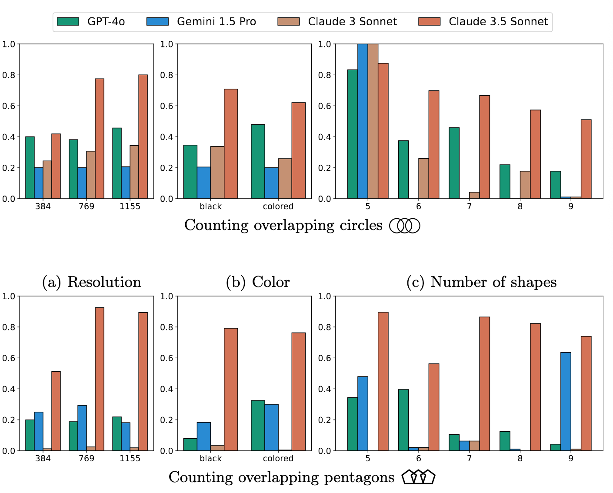</a><figcaption>Panels compare accuracy by resolution, color, and the number of shapes.</figcaption></figure>
<p>The next figure makes the pattern clearer. Gemini has a strong bias: it keeps guessing five circles, while its pentagon counts are close to random guesses. The other three models also show clear preferences. When the ground truth is five circles, all tend to guess five; for five pentagons, their preferences differ.</p>
<figure><h4 class="fig-title">Predicted and actual counts</h4><a class="article-image image-preview--result" style="--image-width:1446px;--image-ratio:1.401162791" href="/assets/blindtest/figure-15.png" data-image-viewer data-pswp-width="1446" data-pswp-height="1032" aria-haspopup="dialog" aria-label="Enlarge image: BlindTest figure 15">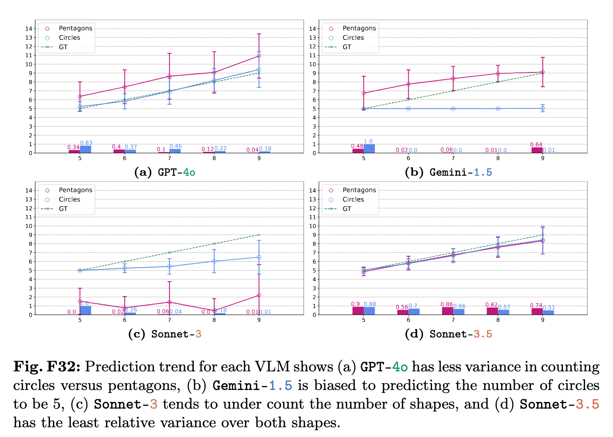</a><figcaption>Each panel compares a model’s answers with the true shape counts.</figcaption></figure>
<h3>Task 5: Counting nested squares</h3>
<p>The VLM must report the number of squares in a nested arrangement.</p>
<p>There are 120 images and 240 question–answer pairs. Variables include square count, line width, and shape position.</p>
<figure><h4 class="fig-title">Nested squares</h4><a class="article-image image-preview--montage" style="--image-width:2908px;--image-ratio:1.000000000" href="/assets/blindtest/figure-16.png" data-image-viewer data-pswp-width="2908" data-pswp-height="2908" aria-haspopup="dialog" aria-label="Enlarge image: BlindTest figure 16">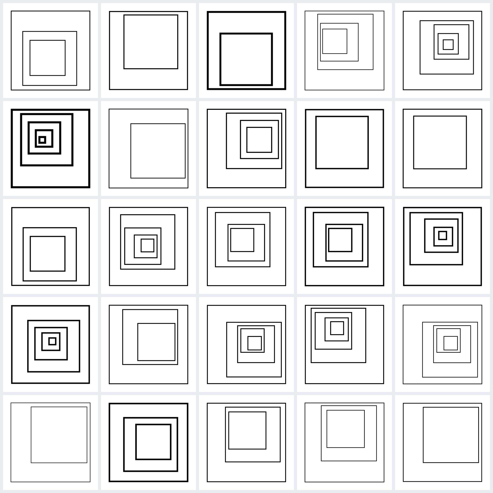</a><figcaption>Examples vary the number, placement, and line width of the squares.</figcaption></figure>
<p>The line-width ablation shows no significant effect.</p>
<figure><h4 class="fig-title">Nested squares by line width</h4><a class="article-image image-preview--result" style="--image-width:720px;--image-ratio:2.033898305" href="/assets/blindtest/figure-17.png" data-image-viewer data-pswp-width="720" data-pswp-height="354" aria-haspopup="dialog" aria-label="Enlarge image: BlindTest figure 17">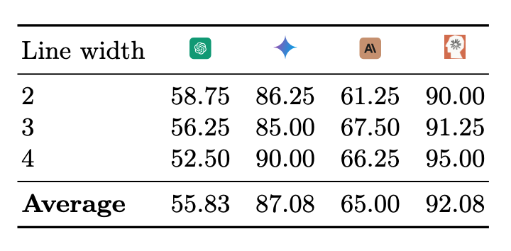</a><figcaption>Each row reports accuracy at a different stroke width.</figcaption></figure>
<h3>Task 6: Counting grid rows and columns</h3>
<p>The VLM must count the rows and columns in a grid image.</p>
<p>There are 264 images and 528 question–answer pairs. Variables include row count, column count, line width, image size, and whether the cells contain text.</p>
<figure><h4 class="fig-title">Rows and columns</h4><a class="article-image image-preview--montage" style="--image-width:2908px;--image-ratio:1.000000000" href="/assets/blindtest/figure-18.png" data-image-viewer data-pswp-width="2908" data-pswp-height="2908" aria-haspopup="dialog" aria-label="Enlarge image: BlindTest figure 18">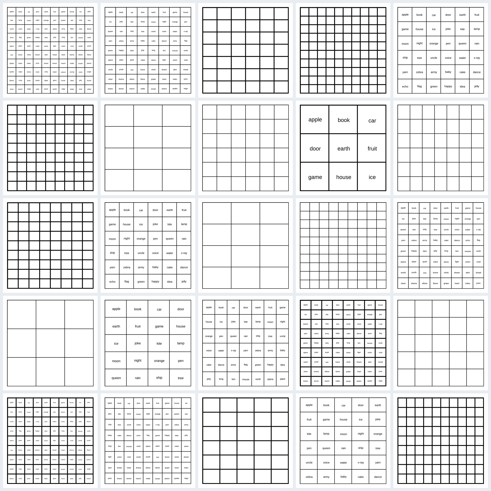</a><figcaption>The grids vary in size and can be empty or contain text.</figcaption></figure>
<p>Adding text to the cells substantially improves performance. Could this be related to the tokenizer?</p>
<figure><h4 class="fig-title">Empty and text-filled grids</h4><a class="article-image image-preview--result" style="--image-width:732px;--image-ratio:2.793893130" href="/assets/blindtest/figure-19.png" data-image-viewer data-pswp-width="732" data-pswp-height="262" aria-haspopup="dialog" aria-label="Enlarge image: BlindTest figure 19">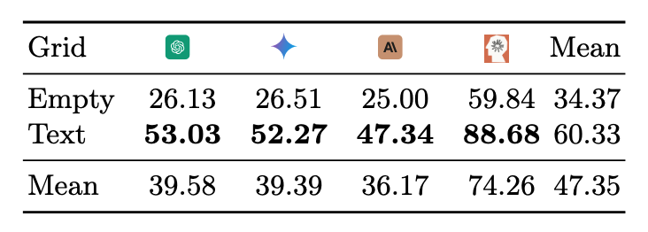</a><figcaption>The table compares counting accuracy by grid content.</figcaption></figure>
<h3>Task 7: Counting routes from A to B</h3>
<p>The VLM must find the number of paths from A to B in a simulated subway map.</p>
<p>There are 180 images and 720 question–answer pairs. The images are entirely synthetic. Grid nodes are randomly selected as turns in the routes, while A, B, C, and D are four simulated stations with fixed positions. Maps are then generated with different numbers of available routes and image sizes.</p>
<figure><h4 class="fig-title">Routes between stations</h4><a class="article-image image-preview--montage" style="--image-width:2908px;--image-ratio:1.000000000" href="/assets/blindtest/figure-20.png" data-image-viewer data-pswp-width="2908" data-pswp-height="2908" aria-haspopup="dialog" aria-label="Enlarge image: BlindTest figure 20">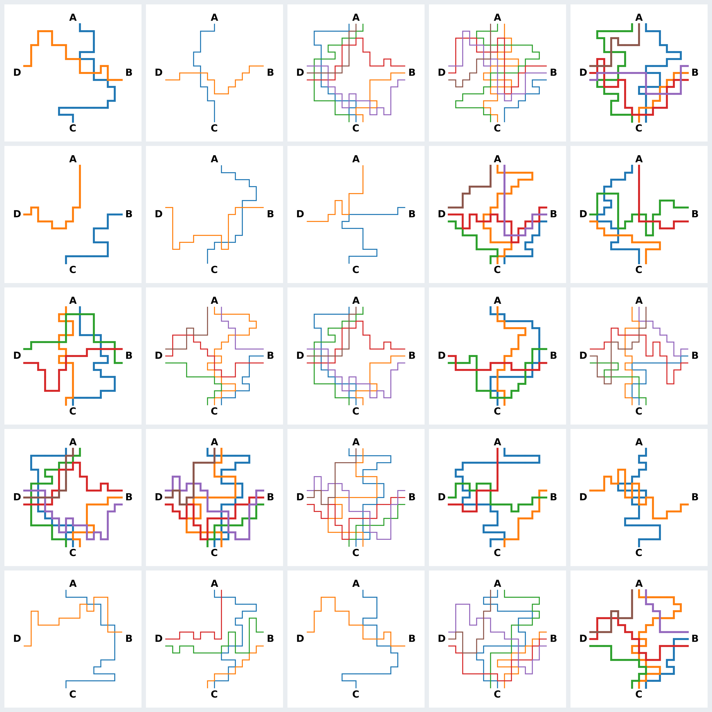</a><figcaption>Synthetic maps provide different numbers of paths from A to B.</figcaption></figure>
<p>The results show that more routes lead to worse model performance. This also matches intuition.</p>
<figure><h4 class="fig-title">Route-count accuracy</h4><a class="article-image image-preview--tall" style="--image-width:732px;--image-ratio:0.986522911" href="/assets/blindtest/figure-21.png" data-image-viewer data-pswp-width="732" data-pswp-height="742" aria-haspopup="dialog" aria-label="Enlarge image: BlindTest figure 21">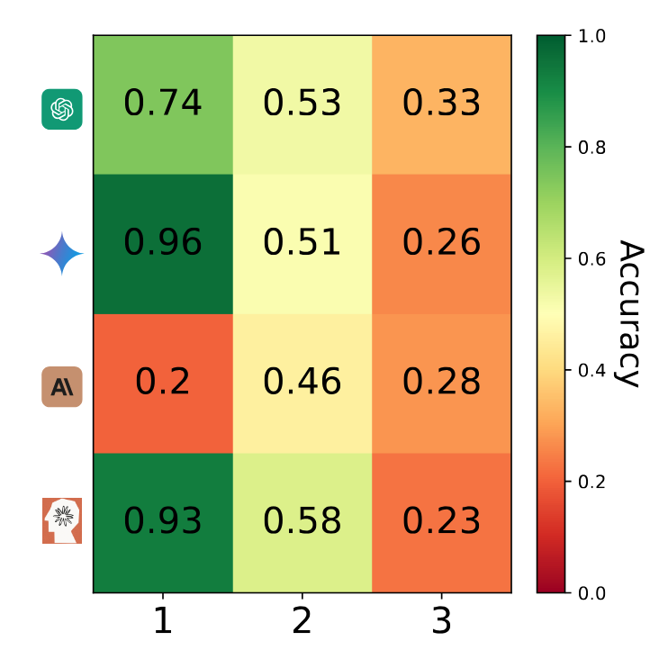</a><figcaption>Columns group accuracy by the true number of routes.</figcaption></figure>
<h2>3 Other findings</h2>
<p>There are many other related findings, including the following.</p>
<h3>Chain of thought offers little help on these low-level perception tasks</h3>
<figure><h4 class="fig-title">Reasoning on low-level perception</h4><a class="article-image image-preview--wide" style="--image-width:1754px;--image-ratio:5.220238095" href="/assets/blindtest/figure-22.png" data-image-viewer data-pswp-width="1754" data-pswp-height="336" aria-haspopup="dialog" aria-label="Enlarge image: BlindTest figure 22">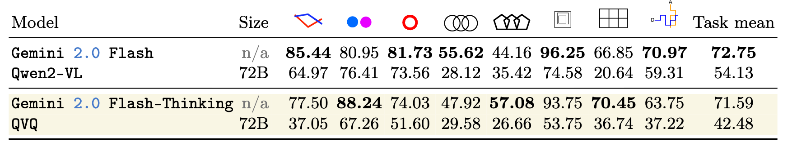</a><figcaption>The table compares results across tasks for models with and without explicit reasoning.</figcaption></figure>
<h3>Asking VLMs to reconstruct images using graphics languages</h3>
<p>This experiment draws on earlier work on VLM image reconstruction: <a href="https://arxiv.org/abs/2408.03940">Pixel Value Prediction: How Well Can Vision Language Models See Image Details?</a>.</p>
<p>Below are reconstructions generated by Sonnet 3.5 using SVG, HTML, JS, and Python. They are a mess, with many key features lost.</p>
<figure><h4 class="fig-title">Reconstruction in graphics languages</h4><a class="article-image image-preview--tall" style="--image-width:1406px;--image-ratio:1.115873016" href="/assets/blindtest/figure-23.png" data-image-viewer data-pswp-width="1406" data-pswp-height="1260" aria-haspopup="dialog" aria-label="Enlarge image: BlindTest figure 23">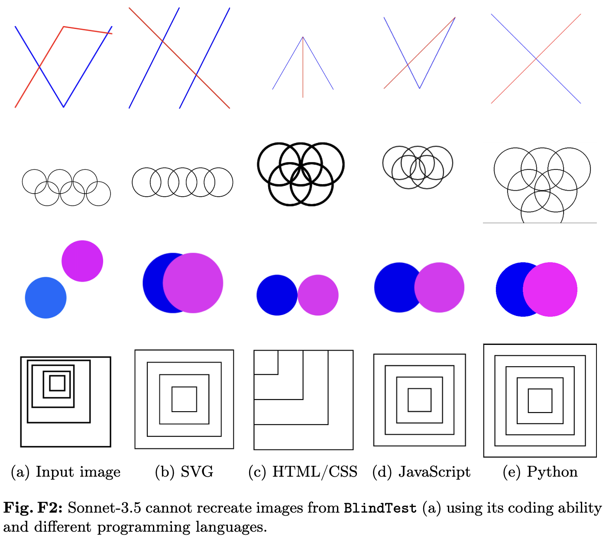</a><figcaption>Sonnet 3.5 reconstructs the inputs with SVG, HTML and JavaScript, or Python.</figcaption></figure>
<h3>Trying to improve performance through training</h3>
<p>Fine-tuning Bunny: the authors fine-tune Bunny on whether two circles intersect, with very poor results. In the figure below, accuracy drops abruptly from 100% to 0% at positive distances, and the pattern becomes more pronounced with larger training sets. This raises the possibility that the model has degenerated into always answering “overlap.” At 50K, this degeneration does occur: the authors report that the model loses the ability to answer and outputs only an end token.</p>
<p>PixelBench also tried to improve performance with synthetic data, without success. The failure here seems even more complete: even in-domain performance shows no significant improvement. That is very strange. Why does it happen?</p>
<figure><h4 class="fig-title">Fine-tuning on synthetic circle examples</h4><a class="article-image image-preview--tall" style="--image-width:1388px;--image-ratio:0.910761155" href="/assets/blindtest/figure-24.png" data-image-viewer data-pswp-width="1388" data-pswp-height="1524" aria-haspopup="dialog" aria-label="Enlarge image: BlindTest figure 24">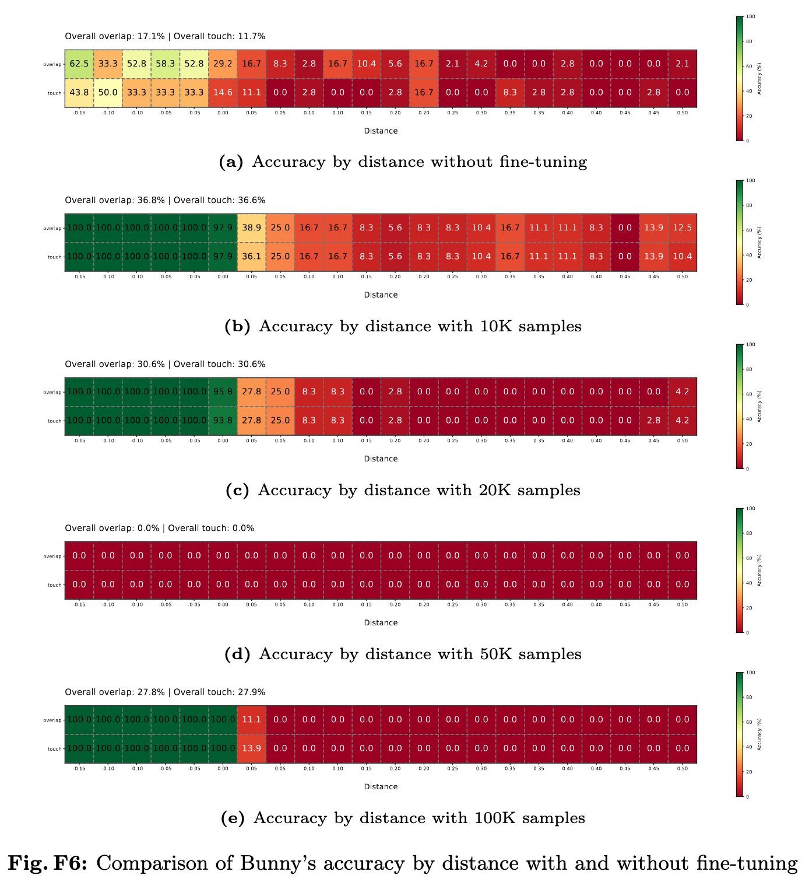</a><figcaption>The heatmaps compare responses after training with different numbers of examples.</figcaption></figure>
<h3>Testing models on simplified problems</h3>
<p>For example, increasing the spacing between adjacent letters in the circled-letter experiment improves accuracy. This is intuitive. In the sixth section on the vision encoder, the authors cite it as evidence that the problem is not OOD: when the setting is simpler, models can answer correctly even though the images are still synthetic OOD images. They argue that failures therefore do not arise from the unfamiliar form of the questions.</p>
<figure><h4 class="fig-title">Spacing around the circled letter</h4><a class="article-image image-preview--tall" style="--image-width:532px;--image-ratio:0.753541076" href="/assets/blindtest/figure-25.png" data-image-viewer data-pswp-width="532" data-pswp-height="706" aria-haspopup="dialog" aria-label="Enlarge image: BlindTest figure 25">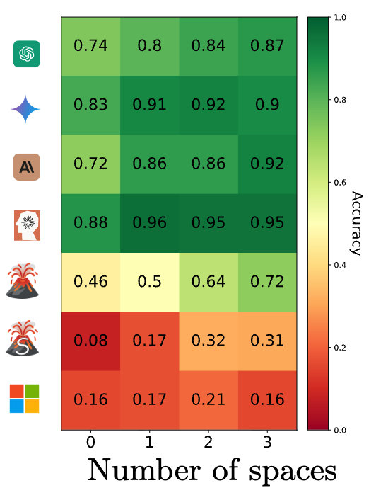</a><figcaption>The columns compare results as adjacent letters are given more space.</figcaption></figure>
<h3>The vision encoder already supplies enough information</h3>
<p>This section seeks to show that poor performance comes neither from synthetic images being rare in the training set and thus OOD, nor from problems with prompts, line colors, and so on. Instead, in harder settings, such as small letter spacing or circle gaps, the model lacks the ability to convert key visual information into answers.</p>
<p>To demonstrate this, the paper uses SigLIP and CLIP, the vision encoders in two small state-of-the-art open-source VLMs: 0.5B LLaVA-OneV-S and 4.2B Phi-3.5. The authors generate roughly twenty thousand examples across two tasks: circle overlap and line intersections.</p>
<p>Features from two stages are then used as inputs to linear classifiers: 1. after the vision encoder but before projection; 2. after projection.</p>
<figure><h4 class="fig-title">Probing the vision encoder</h4><a class="article-image image-preview--tall" style="--image-width:868px;--image-ratio:0.779174147" href="/assets/blindtest/figure-26.png" data-image-viewer data-pswp-width="868" data-pswp-height="1114" aria-haspopup="dialog" aria-label="Enlarge image: BlindTest figure 26">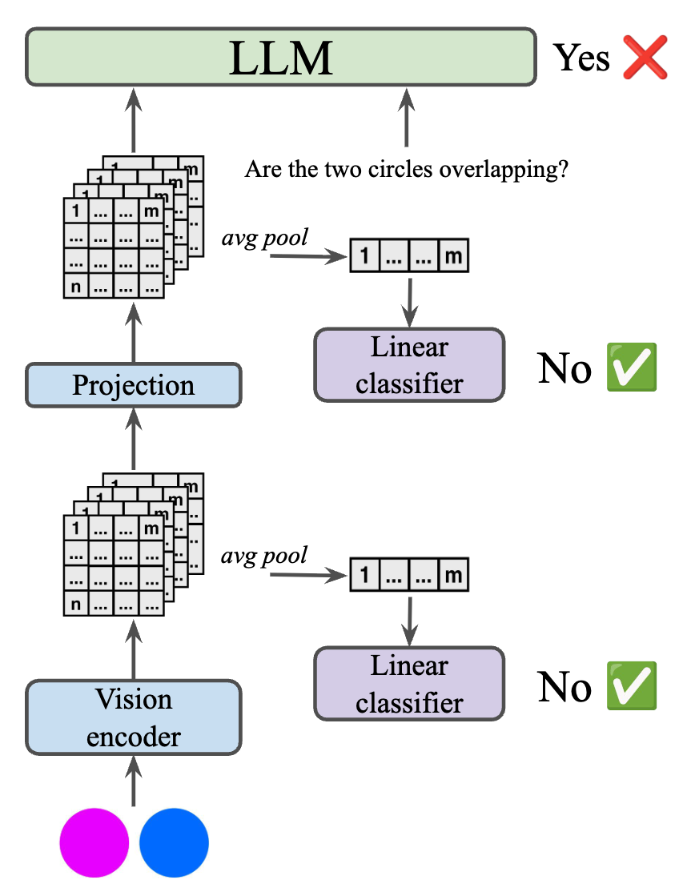</a><figcaption>Linear classifiers read visual features on each side of the projection layer.</figcaption></figure>
<p>The linear classifiers achieve very high accuracy, showing that the vision encoder retains enough visual information to complete the required classification tasks.</p>
<figure><h4 class="fig-title">Linear probe and model accuracy</h4><a class="article-image image-preview--wide" style="--image-width:1008px;--image-ratio:2.739130435" href="/assets/blindtest/figure-27.png" data-image-viewer data-pswp-width="1008" data-pswp-height="368" aria-haspopup="dialog" aria-label="Enlarge image: BlindTest figure 27">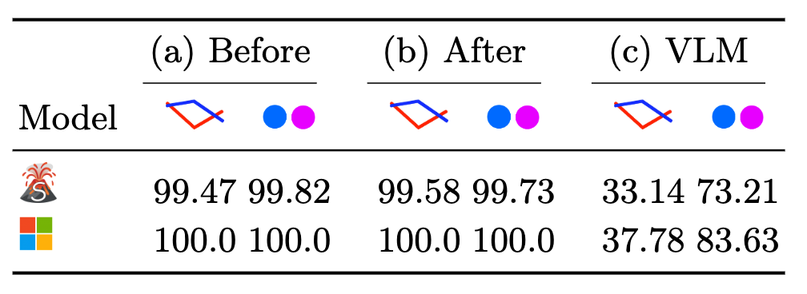</a><figcaption>The table compares linear classifiers before and after projection with the full model’s answers.</figcaption></figure>
<h2>Summary and follow-up</h2>
<h3>Recent publicly reported model results</h3>
<p>I looked at results from newer models. At least Qwen 3.6-27B is already approaching saturation, with scores above 90. Could Qwen 3.8 or Qwen 4-27B get close to 100? I will test that when the time comes. BTW, it is quite surprising that Opus 4.5 performs about the same as Sonnet 3.5.</p>
<p>The following table comes from <a href="https://lf3-static.bytednsdoc.com/obj/eden-cn/lapzild-tss/ljhwZthlaukjlkulzlp/seed2/0214/Seed2.0%20Model%20Card.pdf#page=13">Table 8 of the Seed2.0 model card (page 13)</a>. The metric is Pass@1.</p>
<div class="table-wrap"><table class="results"><thead><tr><th>Model</th><th>BlindTest score</th><th>Source</th></tr></thead><tbody>
<tr><td>Seed2.0 Pro</td><td>98.6%</td><td>ByteDance model card, Table 8</td></tr>
<tr><td>Gemini 3 Pro High</td><td>97.5%</td><td>Same source, evaluated by ByteDance</td></tr>
<tr><td>Seed2.0 Lite</td><td>97.0%</td><td>Same source</td></tr>
<tr><td>GPT-5.2 High</td><td>84.2%</td><td>Same source</td></tr>
<tr><td>Claude Opus 4.5</td><td>77.2%</td><td>Same source</td></tr>
</tbody></table></div>
<p>The following table comes from official Qwen model cards and retains the evaluation results reported in each card.</p>
<div class="table-wrap"><table class="results"><thead><tr><th>Model</th><th>BlindTest score</th><th>Source</th></tr></thead><tbody>
<tr><td>Qwen3.6-27B</td><td>97.0%</td><td><a href="https://huggingface.co/Qwen/Qwen3.6-27B#benchmark-results">Qwen3.6 model card</a></td></tr>
<tr><td>Qwen3.5-35B-A3B</td><td>97.0%</td><td><a href="https://huggingface.co/Qwen/Qwen3.5-122B-A10B#benchmark-results">Qwen3.5 model card</a></td></tr>
<tr><td>Qwen3.5-27B</td><td>96.9%</td><td>Same source</td></tr>
<tr><td>Qwen3.5-122B-A10B</td><td>96.7%</td><td>Same source</td></tr>
<tr><td>Claude Sonnet 4.5</td><td>85.5%</td><td>Same source, evaluated by Qwen</td></tr>
</tbody></table></div>
<h3>Further reading</h3>
<p>On the limitations of MMMU:</p>
<p><a href="https://arxiv.org/abs/2403.20330">Are We on the Right Way for Evaluating Large Vision-Language Models?</a></p>
<p>On late fusion:</p>
<p><a href="https://arxiv.org/abs/2405.09818">Chameleon: Mixed-Modal Early-Fusion Foundation Models</a></p>
<p><a href="https://arxiv.org/abs/2304.08485">Visual Instruction Tuning</a></p>
<p>On visual hallucinations in large models:</p>
<p><a href="https://arxiv.org/abs/2401.06209">Eyes Wide Shut? Exploring the Visual Shortcomings of Multimodal LLMs</a></p>
<p>On image reconstruction:</p>
<p><a href="https://arxiv.org/abs/2408.03940">Pixel Value Prediction: How Well Can Vision Language Models See Image Details?</a></p>
<p><a href="https://arxiv.org/abs/2506.07803">Image Reconstruction as a Tool for Feature Analysis</a></p>
<p><a href="https://arxiv.org/abs/2510.11690">Diffusion Transformers with Representation Autoencoders</a></p>
<p><a href="https://openaccess.thecvf.com/content_cvpr_2015/html/Mahendran_Understanding_Deep_Image_2015_CVPR_paper.html">Understanding Deep Image Representations by Inverting Them</a></p>
<p>On attribution inside models:</p>
<p><a href="https://arxiv.org/abs/2610.21114">Spectral-Spatial Interpretation</a></p>

</div>

</div>
```
