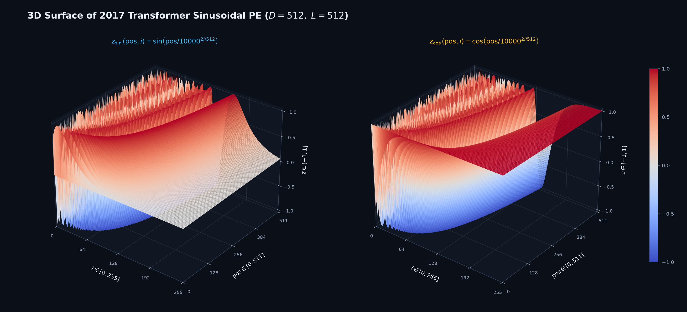
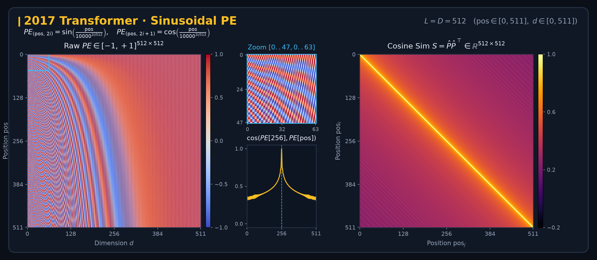
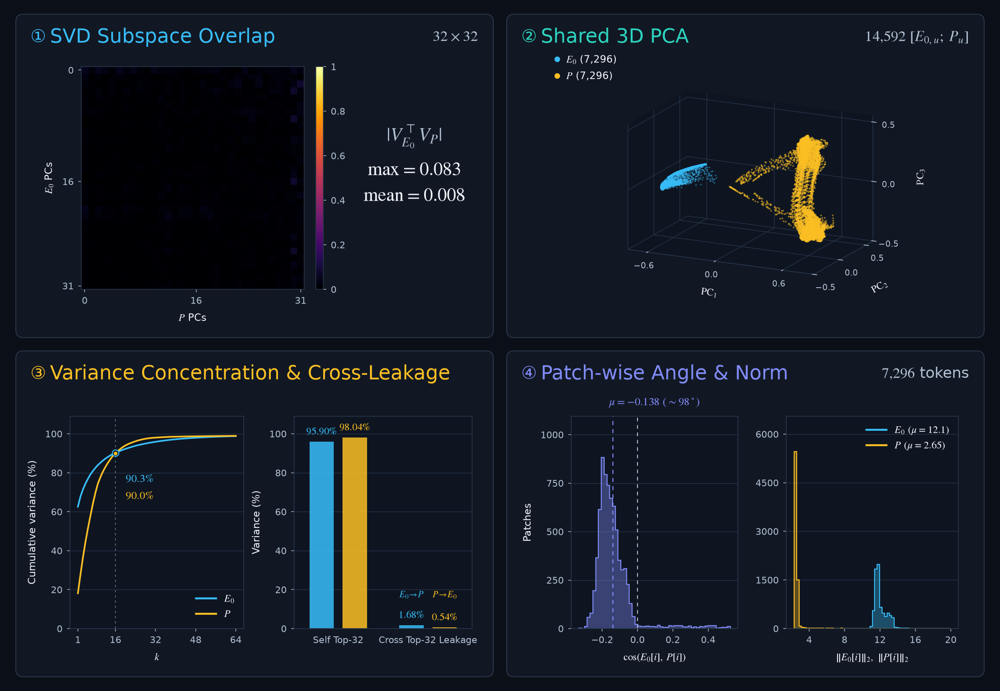
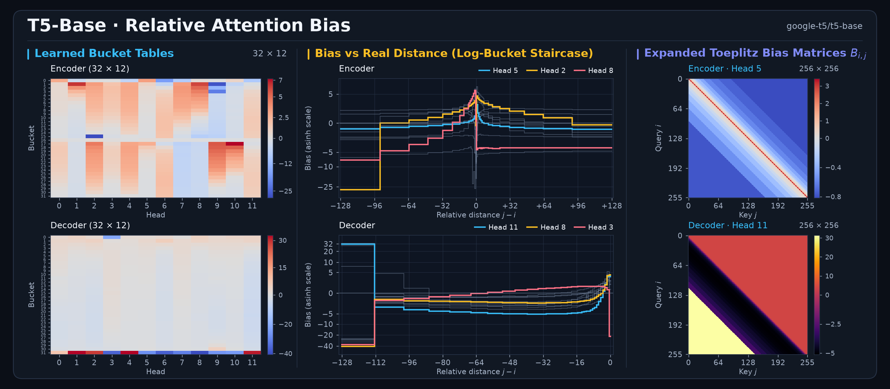
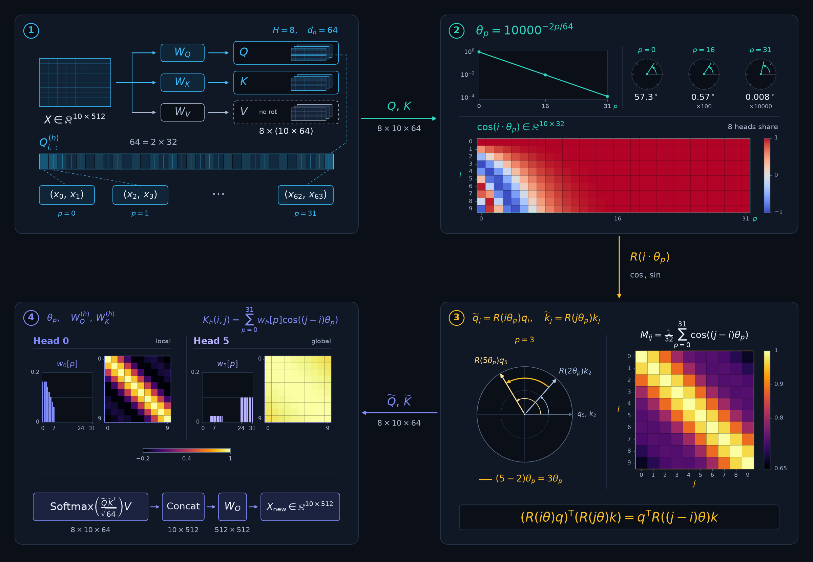
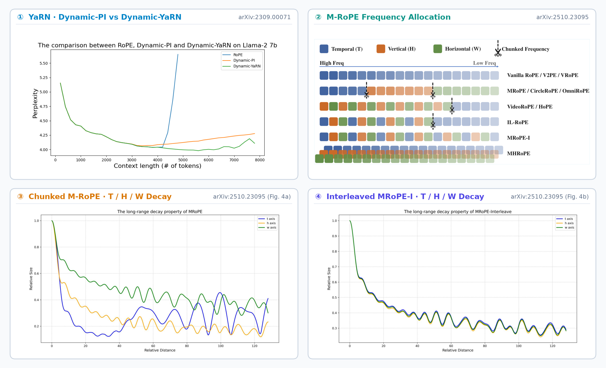

> Lately I wanted to shore up my fundamentals, so I started dissecting Qwen3.8-27B from scratch—from how pixels in an image turn into tokens to the exact shape of the weights in every layer—walking through the math myself before comparing other model families.
> Halfway through, I realized positional encoding was trickier than I expected, so I broke it out into its own post: from early APE to today's 2D-RoPE and M-RoPE, and a look at what approaches might come next.

A tokenizer maps repeated tokens to the same IDs regardless of where they occur. This is true of text tokens (1D), image patches (2D), and video frames (3D). Consider “今天是个大晴天啊” (“Today is a lovely sunny day”). If the two occurrences of “天” are tokenized separately, both receive the same ID. Feed the token embeddings directly into attention and the model has no way to tell whether a word comes near the start or end of a sentence, an object sits near the center or edge of an image, or a frame appears early or late in a video. Positional encoding supplies this information.

### Absolute Positional Encoding (APE)

A common approach is to add a position vector to each token vector. Let $t_i$ be the vector for token $i$ and $p_i$ the vector for that position. The model receives the sequence $[t_i + p_i]$. Identical tokens at different positions can now have distinct input vectors. This is **absolute positional encoding**.

Where do the position vectors come from? The **original Transformer (2017)**[^transformer] computed them directly with sines and cosines. These bounded, periodic functions fill the $2i$ and $2i+1$ components at position $\text{pos}$ using a range of frequencies.

$$
PE_{(\text{pos},\, 2i)} = \sin\!\left(\frac{\text{pos}}{10000^{2i / d_{\text{model}}}}\right), \qquad PE_{(\text{pos},\, 2i+1)} = \cos\!\left(\frac{\text{pos}}{10000^{2i / d_{\text{model}}}}\right)
$$

These two functions produce the following surfaces.

{fig-alt="Surfaces for the sine and cosine components of the original Transformer position encoding. Low-index components oscillate quickly across positions and high-index components change slowly." data-figure-title="Sine and cosine components" data-pswp-width="2880" data-pswp-height="1312"}

The next figure shows the position encoding matrix for a sequence of 512 tokens. Taking the normalized dot product between the vectors at positions $i$ and $j$ gives the cosine similarity matrix on the right. A bright main diagonal, flanked by symmetric ripples, makes the regularity of the encoding visible.

{fig-alt="Left, the sinusoidal positional encoding matrix for 512 tokens. Right, the corresponding pairwise cosine similarity matrix with a bright diagonal and symmetric ripples." data-figure-title="Positional encoding and cosine similarity" data-pswp-width="2200" data-pswp-height="960"}

::: {.ojs-panel}
<!-- static-fallback-start: Adjust the dimension d_model and reference position pos_ref to see symmetry and translation invariance in the cosine similarity curve. Try the [interactive article](https://apogeeio.github.io/blog/positional-encoding/). -->
<figure class="pe-viz" data-pe-demo="sinusoidal">
<h4>Sinusoidal PE cosine similarity and translation invariance</h4>
<figcaption>Pairs of sine and cosine channels make similarity a function of relative distance. The two curves trace the same pattern 32 positions apart.</figcaption>
</figure>
<!-- static-fallback-end -->
:::

Intuitively, the sum gives the model a different input representation for a token at each position. At position $i$, a token vector $t$ becomes $t + p_i$. This expands each point in the original embedding space into a family of vectors of the form $t + p_i$.

One concern is a collision. If $x + p_i = y + p_j$, the semantic difference $x - y = p_j - p_i$ exactly cancels the positional offset. The two tokens then enter the first layer as the same vector $z$.

These collisions are rare in practice. One reason is **near-orthogonality** in high dimensions. Two random vectors in a high-dimensional space tend to form an angle close to $90^\circ$. Consider the squared distance between the two position-aware token vectors.

$$
\| (x - y) + (p_i - p_j) \|^2 = \|x - y\|^2 + \|p_i - p_j\|^2 + 2 \underbrace{(x - y) \cdot (p_i - p_j)}_{\text{cross term}}
$$

When the cross term is close to $0$, the squared distance stays positive. The semantic and positional differences contribute along nearly perpendicular directions, so their squared magnitudes add.

Another reason is **subspace decoupling**. During training, semantic features and positional encodings can come to occupy nearly orthogonal subspaces of the $D$-dimensional representation. Geometrically, the sum $x + p_i$ then behaves much like **concatenating** the semantic and positional vectors in separate groups of orthogonal dimensions. This makes exact collisions unlikely.

The figure below shows this separation in `Qwen3.8-27B`. It compares the learned position table $P$ with the feature matrix $E_0$ obtained from a real image. The SVD subspaces, a shared 3D PCA projection, the concentration of variance, and the distributions of angles and norms all show a separation between the feature and position spaces.

{fig-alt="SVD subspaces, shared 3D PCA, variance concentration, and distributions of angles and norms for the Qwen3.8-27B position table P and image features E0." data-figure-title="Position and feature subspaces" data-pswp-width="2400" data-pswp-height="1660"}

The $\sin/\cos$ scheme has three advantages over simpler encodings such as $0, 1, 2, \dots$ or evenly spaced values in $[0, 1]$.

1. **Bounded values.** Sines and cosines stay in $[-1, 1]$, even at positions where a raw index $0, 1, 2, \dots$ would add a large value.
2. **Defined for arbitrary context lengths.** A scheme normalized to $[0, 1]$ needs a total sequence length. In the sinusoidal formula, $\text{pos}$ can be arbitrarily large.
3. **Translation invariance.** Pairs of positions with the same relative distance have the same cosine similarity.

The scheme also has two drawbacks.

1. **Position information enters the value matrix $V$.** In standard attention, $V = (X + P)W_V$. Position information influences which tokens are attended to ($QK^\top$) and also enters the values in $V$ that carry semantic content.
2. **The position signal enters $X$ only once.** Repeated residual connections and normalization can weaken it as the network gets deeper.

Two choices characterize the 2017 approach.

1. It encodes absolute position at the input $X$. Later work also injects relative distance into computations such as $QK^\top$.
2. It computes the position vectors from a fixed formula. Later models such as **BERT and GPT-2**[^bert] learn a position table.

### Relative Positional Encoding (RPE)

**T5 relative position bias**[^t5] adds position information to the **attention scores at every layer**. This helps preserve the signal as it passes through the network.

T5 uses the original input vectors $X$ and removes the additive step $X + P$. At each layer it adds a bias $B$ that depends only on relative distance, after computing $QK^\top$ and before applying $\text{Softmax}$.

$$
\text{Attention}(Q, K, V) = \text{Softmax}\!\left(\frac{QK^\top}{\sqrt{d}} + B\right) V
$$

The bias $B$ is learned. Each head has a table of biases for logarithmically spaced distance buckets. The first encoder layer and the first decoder layer each learn a table and share it across the layers of the corresponding stack. Nearby distances get their own scalar bias, such as distances `0` through `−15` in the decoder and `−7` through `+7` in the encoder. Farther positions share progressively wider buckets, with a final bucket covering distances of 128 and beyond.

Each head can learn a distinct distance preference, and the bucket scheme can assign a bias even to very long inputs. Resolution drops at long distances. For example, distances of 200 and 2,000 fall in the same bucket.

The figure uses weights learned by `google-t5/t5-base`. In the bidirectional encoder, bucket 0 corresponds to $d = 0$. Buckets 1–7 encode the exact distances $-1 \sim -7$ to the left. Buckets 8–15 cover progressively wider intervals farther to the left. Buckets 17–23 and 24–31 mirror these ranges to the right. Bucket 16 is unused.
The decoder uses a causal mask and one-sided buckets. Bucket 0 corresponds to $d = 0$, buckets 1–15 encode the exact distances $-1 \sim -15$, and buckets 16–31 group progressively farther positions to the left.
Heads learn different preferences, such as attending nearby or to the left. The small bias table limits the complexity of the patterns they can represent.

{fig-alt="T5-base relative position bias heatmaps. The encoder has bidirectional distance buckets, the decoder has current-position and leftward buckets, and the learned biases vary by head." data-figure-title="T5 relative position bias" data-pswp-width="2400" data-pswp-height="1050"}

**ALiBi**[^alibi] introduces a parameter-free linear penalty. The attention score receives a larger penalty as distance increases.

$$
\text{Attention}(Q, K, V) = \text{Softmax}\!\left(\frac{QK^\top}{\sqrt{d}} - m \cdot (i - j)\right) V
$$

Each attention head gets its own slope $m$ from a fixed geometric sequence. Steeper slopes encourage local attention, and shallower slopes allow heads to attend over longer distances.
This simple scheme extrapolated well to longer sequences. Its monotonic distance penalty imposes a preference for nearby tokens, which limits the distance patterns it can express. Adding the bias to the scores also has implementation and scaling costs.

::: {.ojs-panel}
<!-- static-fallback-start: Select an attention head with slope m = 2^-h to see how the bias -m × |i - j| decreases with relative distance. Try the [interactive article](https://apogeeio.github.io/blog/positional-encoding/). -->
<figure class="pe-viz" data-pe-demo="alibi">
<h4>ALiBi linear bias across attention heads</h4>
<figcaption>The chart isolates the positional penalty. Steeper heads retain a narrower receptive field.</figcaption>
</figure>
<!-- static-fallback-end -->
:::

Many subsequent models adopted **RoPE (rotary position embedding)**[^rope].

### Rotary Position Embedding (RoPE)

RoPE retains the idea of encoding position with multiple frequencies. It rotates $Q$ and $K$ at each layer. For example, a model with 8 attention heads and a 512-dimensional token representation has $d = 64$ components in each head, grouped into 32 coordinate pairs ($512 = 8 \times 64 = 8 \times (32 \times 2)$). Each pair $p$ is assigned an angular frequency $\theta_p = \text{base}^{-2p/d}$. This frequency depends on the pair index and is shared across heads and layers.

The two coordinates in each pair are treated as a vector and rotated by the token position times the angular frequency. The resulting dot product is translation-invariant.

$$
[R(i\theta)\, q]^\top [R(j\theta)\, k] = q^\top R\big((j - i)\theta\big)\, k
$$

Computing the original dot product $q^\top k$ now amounts to inserting a rotation $R(\Delta\theta)$ on one side, with $\Delta = j - i$ the relative distance. A larger $\theta$ rotates more rapidly and makes the result more sensitive to changes in relative distance. A smaller $\theta$ rotates more slowly. At sufficiently small $\theta$, the rotation $R(\Delta\theta)$ approaches the identity $R(0) = I$. For that pair, the dot product is nearly the same as in ordinary attention.

The different frequencies $\theta_p = \text{base}^{-2p/64}$ assigned to each pair $p$ give the model both fast and slow rotation planes. By adjusting the corresponding weights in $W_Q, W_K$, the model can combine these frequency components and learn complex preferences over distance, much like a Fourier representation.

{fig-alt="RoPE groups channels into two-dimensional rotation planes and assigns each plane a frequency. A model can combine high and low frequencies to learn preferences over relative distance." data-figure-title="RoPE rotation planes" data-pswp-width="2400" data-pswp-height="1660"}

RoPE has four practical advantages.

1. **$X$ and $V$ carry semantic content.** RoPE leaves the input $X$ and the values $V$ unrotated. Position enters attention through the $QK^\top$ dot product, avoiding the additive mixing of position and content in APE.
2. **No learned position parameters.** A formula supplies the rotation frequencies, and every layer applies a fresh rotation to its queries and keys.
3. **Norm preservation.** Rotation leaves the vector length unchanged.
4. **Compatible with FlashAttention and the KV cache.**[^flashattn] RoPE rotates $Q, K$ before they enter FlashAttention, so the attention kernel needs no additional memory traffic for a T5-style bias matrix. The KV cache can store keys already rotated as $\tilde{K}$. Inference reuses those cached $\tilde{K}$ values directly.

RoPE still faces challenges in length extrapolation. A model trained with a 4K context window can degrade sharply when used directly at 32K. At longer distances, the low-frequency dimensions produce rotations beyond those seen during training. The one-dimensional scheme also needs adaptation for images and video.

Several extensions address long-context extrapolation.

- **Position Interpolation (PI)**[^pi] rescales $\text{pos}$ uniformly, mapping an extended context such as 32K back into the original 4K interval. It slows rotations at every frequency, shrinking the angle between nearby tokens in high-frequency channels and potentially losing local detail.
- **NTK-aware scaling**[^ntk] increases `rope_theta`, the `base` in $\theta_p = \text{base}^{-2p/d}$. High-frequency channels change little because their exponents are close to zero, while low-frequency channels gain longer wavelengths and cover greater distances.
- **YaRN**[^yarn] treats frequencies differently based on their wavelengths. It preserves high frequencies whose wavelengths are much shorter than the training window and were well covered during training. It interpolates low frequencies to keep long-distance angles in range and blends the two regimes over the intermediate frequencies.

::: {.ojs-panel}
<!-- static-fallback-start: Compare the rotation angles and wavelengths of Standard RoPE, PI, NTK-Aware and YaRN. Try the [interactive article](https://apogeeio.github.io/blog/positional-encoding/). -->
<figure class="pe-viz" data-pe-demo="rope">
<h4>RoPE rotations and long-context scaling</h4>
<figcaption>The dials show the angle modulo one turn. The bars show wavelength on a logarithmic scale, with the original 4,096-token training window as a reference.</figcaption>
</figure>
<!-- static-fallback-end -->
:::

**Partial RoPE** rotates half of the dimensions in each head. The remaining dimensions use the unrotated dot product and can carry semantic information across the sequence.

### `2D-RoPE` and `3D M-RoPE`

Image patches and video tokens also need position information. Their positions have two or three coordinates, so the one-dimensional RoPE scheme must be extended to cover them.

The basic idea is to replace a single index $i$ with coordinates $(h, w)$ or $(t, h, w)$. The rotation planes are then assigned to groups for width, height, and, for video, time. Each group computes rotations using its own coordinate.

For example, the ViT image encoder in `Qwen3.8-27B` follows the approach of **RoPE-ViT**[^ropevit]. With `dim = d_h / 2 = 36`, it generates 18 angular frequencies (`inv_freq`), from fast to slow. Both height `H` and width `W` use all 18 frequencies, for a total of 36 rotation planes. Each spatial axis gets the full range of frequencies.

Early **M-RoPE (Qwen2-VL and Qwen2.5-VL)**[^mrope] assigned contiguous blocks of frequencies as `[TTT...HHH...WWW]`. Time received the high frequencies and width received the low frequencies, reducing local resolution along the horizontal axis. The later interleaved version, `apply_interleaved_mrope` in **Qwen3.5 and Qwen3.8**, uses a pattern like `[THWTHWTHW...TT]` so that time, height, and width all get both fast and slow frequencies.

The final figure compares how YaRN improves length extrapolation and how interleaved M-RoPE distributes frequencies to preserve local resolution.

{fig-alt="Diagram of YaRN frequency-band scaling for context extension and frequency interleaving in newer M-RoPE implementations." data-figure-title="YaRN and interleaved M-RoPE" data-pswp-width="2400" data-pswp-height="1460"}

Overall, positional encoding involves many routes, improvements, and mathematical principles—especially RoPE, which was originally derived from complex numbers and connects closely to rotations and frequency decomposition. For readers interested in the details, there is a collection of further reading[^rope-reading], mostly written by Jianlin Su, the author of RoPE.

Of course, RoPE's rise to mainstream adoption is closely tied to how well it fits with **FlashAttention**[^flashattn]. In the past, FlashAttention was a nearly universal standard and modifying its kernel was expensive—rewriting it solely for positional encoding carried too high a cost. Today the landscape has shifted: the rise of coding agents has greatly lowered kernel development costs, and multiple studies have identified limitations of RoPE in long-context scenarios:

1. **Attention collapse and long-range oscillatory noise (Oscillatory Noise & Semantic Interference)**: RoPE couples positional rotation directly onto semantic feature channels. As context length grows, high-frequency dimensions rotate so rapidly that they behave like pseudo-random noise, while scaling low-frequency dimensions for extrapolation (e.g., increasing `base` in YaRN or NTK) reduces resolution and increases attention entropy (flattening attention so it struggles to focus on key tokens).
2. **Imposed local bias hurts global retrieval (Retrieval vs. Recency)**: Several works (such as **RNoPE (interleaved layers)**[^rnope] and **iRoPE (Llama 4)**[^irope]) find that RoPE attention layers carry an inherent distance decay and periodic bias. On ultra-long needle-in-a-haystack (NIAH) tasks or long-horizon state tracking, **layers without positional encoding (NoPE, relying solely on the causal mask for implicit position)**[^nope] **achieve significantly higher global retrieval accuracy than RoPE**.
3. **Static geometric distance vs. dynamic contextual distance**: In natural language and code, meaningful "distance" is often data-dependent (e.g., crossing code blocks or state transitions rather than a fixed number of tokens). New approaches like **PaTH (Position Encoding via Accumulating Householder Transformations)**[^path] replace RoPE's fixed rotation matrices with data-dependent cumulative Householder reflection matrices.

There are now many proposals aiming to replace or scale back RoPE—such as **NoPE (no positional encoding)**[^nope], **RNoPE (interleaved layers)**[^rnope], and **data-dependent dynamic positional transformations (such as PaTH / state-space fusion)**[^path]. Mainstream model families are also progressively reducing their reliance on RoPE, including **iRoPE**[^irope] in Llama 4, interleaved local RoPE and global attention in **Gemma 2 / 3**[^gemma], and "large NoPE + tiny decoupled RoPE" in **DeepSeek MLA**[^mla]. We will leave a detailed breakdown of each model family's architectural choices for a future post.

Overall, positional encoding is both a theoretical and an engineering problem. Its derivation involves substantial mathematical analysis, while the engineering practices of major model families have given rise to diverse architectural variants. As one of the areas in model architecture where human inductive bias remains most prominent, it still offers plenty to explore.

[^transformer]: Vaswani et al. (2017). [Attention Is All You Need](https://arxiv.org/abs/1706.03762). NeurIPS 2017.
[^bert]: Devlin et al. (2019). [BERT: Pre-training of Deep Bidirectional Transformers for Language Understanding](https://arxiv.org/abs/1810.04805). NAACL 2019. Radford et al. (2019). [Language Models are Unsupervised Multitask Learners](https://cdn.openai.com/better-language-models/language_models_are_unsupervised_multitask_learners.pdf). OpenAI technical report.
[^t5]: Raffel et al. (2020). [Exploring the Limits of Transfer Learning with a Unified Text-to-Text Transformer](https://arxiv.org/abs/1910.10683). JMLR 21.
[^alibi]: Press, Smith, and Lewis (2022). [Train Short, Test Long: Attention with Linear Biases Enables Input Length Extrapolation](https://arxiv.org/abs/2108.12409). ICLR 2022.
[^rope]: Su et al. (2021). [RoFormer: Enhanced Transformer with Rotary Position Embedding](https://arxiv.org/abs/2104.09864). arXiv preprint.
[^flashattn]: Dao et al. (2022). [FlashAttention: Fast and Memory-Efficient Exact Attention with IO-Awareness](https://arxiv.org/abs/2205.14135). NeurIPS 2022.
[^pi]: Chen et al. (2023). [Extending Context Window of Large Language Models via Positional Interpolation](https://arxiv.org/abs/2306.15595). arXiv preprint.
[^ntk]: bloc97 (2023). [NTK-Aware Scaled RoPE allows LLaMA models to have extended (8k+) context size without any fine-tuning and minimal perplexity degradation](https://www.reddit.com/r/LocalLLaMA/comments/14lz7j5/). Original r/LocalLLaMA post.
[^yarn]: Peng et al. (2024). [YaRN: Efficient Context Window Extension of Large Language Models](https://arxiv.org/abs/2309.00071). ICLR 2024.
[^ropevit]: Heo et al. (2024). [Rotary Position Embedding for Vision Transformer](https://arxiv.org/abs/2403.13298). ECCV 2024.
[^mrope]: Wang et al. (2024). [Qwen2-VL: Enhancing Vision-Language Model's Perception of the World at Any Resolution](https://arxiv.org/abs/2409.12191). Bai et al. (2025). [Qwen3-VL Technical Report](https://arxiv.org/abs/2511.21631). Huang et al. (2025). [Revisiting Multimodal Positional Encoding in Vision-Language Models](https://arxiv.org/abs/2510.23095). Qwen Team. [Qwen3.8-27B model card](https://huggingface.co/Qwen/Qwen3.8-27B).
[^rope-reading]: Jianlin Su (2021). [让研究人员绞尽脑汁的 Transformer 位置编码](https://spaces.ac.cn/archives/8130); [Transformer 升级之路：1、Sinusoidal 位置编码追根溯源](https://spaces.ac.cn/archives/8231); [Transformer 升级之路：2、博采众长的旋转式位置编码](https://spaces.ac.cn/archives/8265); [Transformer 升级之路：4、二维位置的旋转式位置编码](https://spaces.ac.cn/archives/8397). Scientific Spaces. Biderman et al. (2021). [Rotary Embeddings: A Relative Revolution](https://blog.eleuther.ai/rotary-embeddings/). EleutherAI Blog. Su et al. (2021). [RoFormer: Enhanced Transformer with Rotary Position Embedding](https://arxiv.org/abs/2104.09864). arXiv preprint.
[^nope]: Kazemnejad et al. (2023). [The Impact of Positional Encoding on Length Generalization in Transformers](https://arxiv.org/abs/2305.19466). NeurIPS 2023.
[^rnope]: Yang, B. et al. (2025). [Rope to Nope and Back Again: A New Hybrid Attention Strategy](https://arxiv.org/abs/2501.18795). NeurIPS 2025.
[^irope]: Meta AI (2025). [The Llama 4 herd: The beginning of a new era of natively multimodal AI innovation](https://ai.meta.com/blog/llama-4-multimodal-intelligence/). Official release.
[^path]: Yang, S. et al. (2025). [PaTH Attention: Position Encoding via Accumulating Householder Transformations](https://arxiv.org/abs/2505.16381). arXiv preprint.
[^gemma]: Gemma Team (2024). [Gemma 2: Improving Open Language Models at a Practical Size](https://arxiv.org/abs/2408.00118). Gemma Team (2025). [Gemma 3 Technical Report](https://arxiv.org/abs/2503.19786).
[^mla]: DeepSeek-AI (2024). [DeepSeek-V2: A Strong, Economical, and Efficient Mixture-of-Experts Language Model](https://arxiv.org/abs/2405.04434). See §2.1.1, Decoupled Rotary Position Embedding.
