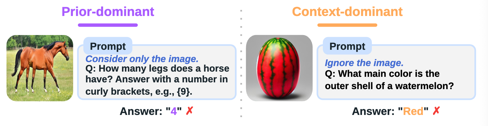
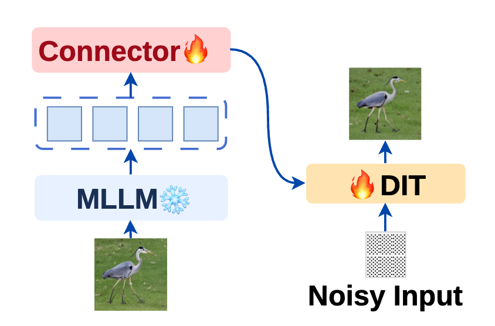
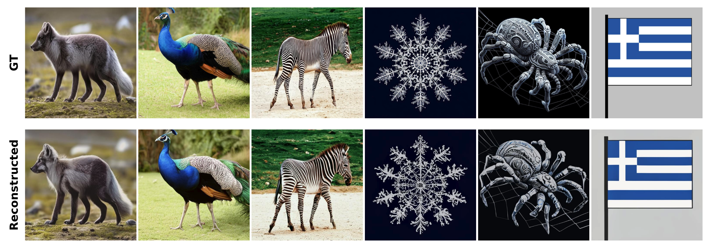
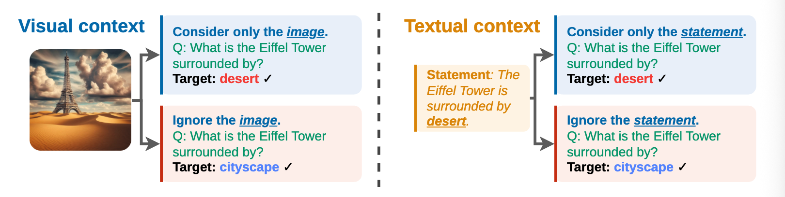
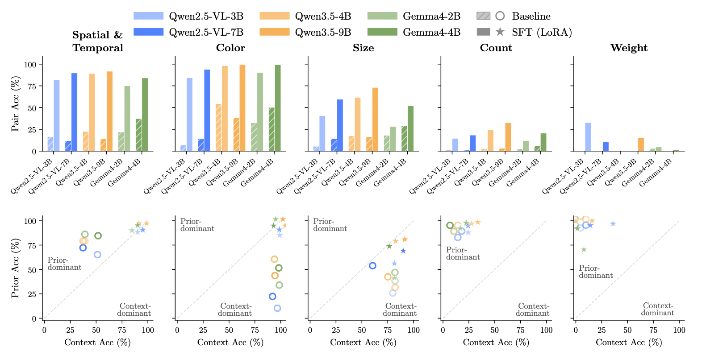
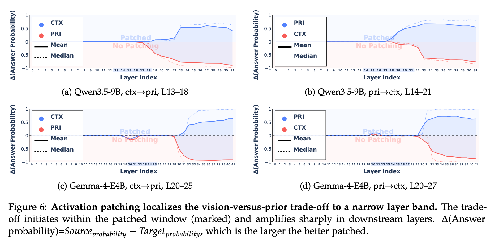
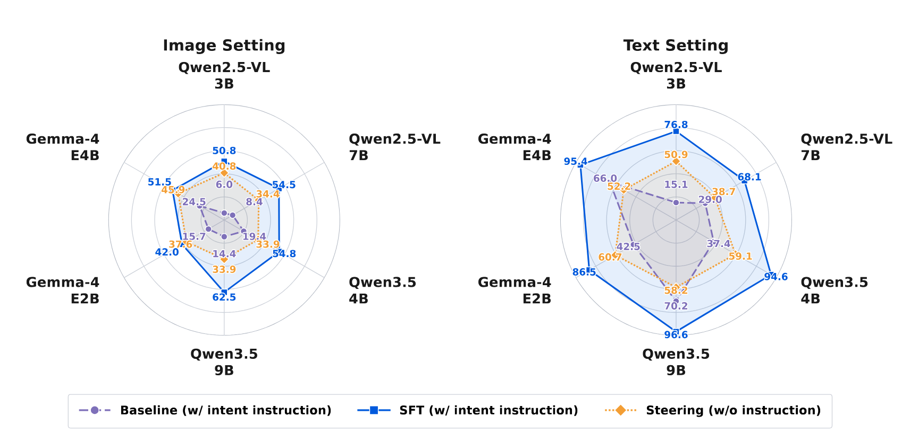

A recent July paper from the University of Copenhagen: **Seeing or Knowing? Visual Context Sensitivity in Multimodal Large Language Models**[^seeing-or-knowing].

The paper investigates why multimodal large language models perform poorly in counterfactual settings and the mechanisms behind those failures. Two aspects caught my eye in particular:

1. It uses image reconstruction to diagnose whether visual information is actually lost during encoding;
2. Following the **CCS**[^ccs] framework, it conducts layer-by-layer quantitative causal analysis inside the neural network.

Here is a brief walkthrough of my takeaways.

## Abstract

When we talk about the visual capabilities of MLLMs, we are usually conflating two distinct abilities:

1. **Perception**: the model's ability to faithfully receive and encode the information present in an image. Ideally this encoding should be as complete and comprehensive as possible—preserving fine details, including high-frequency components, so the model does not miss visual cues. This stage is largely task- and semantics-agnostic.
2. **Utilization**: the model's ability to leverage task-relevant visual information to answer a question. Here we only care about semantics relevant to the task at hand—as long as coarse, subject-level information survives, discarding unrelated details does not matter. In many tasks, coarse low-frequency structure is all that is needed rather than fine high-frequency detail.

The central thesis of the paper is straightforward: when facing MLLM failures, we first need a principled way to disentangle which of these two capabilities broke down before attempting targeted remedies.

Specifically:

1. Using generative image reconstruction, the authors show that perceptual representations preserve enough coarse subject-level information to solve the task—pointing the finger at **utilization** rather than **perception**;
2. Building on the **CCS**[^ccs] (Controllable Context Sensitivity) framework, they localize where utilization breaks down, attributing it to conflicts between parametric world-knowledge priors and visual evidence, and introduce a 1D subspace steering mechanism to modulate that trade-off.

Overall, the paper focuses on counterfactual and prior-biased settings where visual and linguistic signals collide—leaning toward high-level semantics, whereas my own primary interest lies closer to low-level perception.

## Introduction

It has been widely observed that MLLMs often rely heavily on their parametric world knowledge—a phenomenon summarized as *VLMs are biased*. Two competing hypotheses have been proposed to explain this:

- **H1 (Perception failure)**: blames the perceptual stage, arguing that vision encoders discard crucial visual details (as in **Eyes Wide Shut**[^ews]); left with degraded visual evidence, the model falls back on world knowledge and guesses from its prior.
- **H2 (Utilization failure)**: argues that because the LLM backbone is pretrained on vastly more text tokens than paired image–text data, text priors easily overwhelm image context, preventing the model from properly utilizing information that is already encoded in the visual stream.

Crucially, pure perceptual degradation cannot explain the opposite failure mode—**context-dominant** errors, where the model stubbornly follows anomalous visual features even when explicitly instructed to ignore the image and answer from world knowledge. This suggests the bottleneck lies in cross-modal arbitration rather than missing visual features: the model lacks a reliable policy for when to trust visual evidence versus parametric priors, especially when the two conflict.

Existing end-to-end multimodal benchmarks bundle perception and utilization into a single score. This paper separates them explicitly by probing coarse-grained attributes rather than fine-grained details that vision encoders are already known to drop (e.g., **V\***[^v-star]).

By reconstructing input images directly from frozen MLLMs, the authors verify that coarse counterfactual attributes survive intact to the final layer—confirming that failures stem from utilization rather than perception. They then adapt the **CCS**[^ccs] framework into **CVCS** (Controllable Visual Context Sensitivity) to steer visual reliance along a compact one-dimensional subspace.

Key contributions and findings include:

- A generative probe for auditing preserved visual information;
- **WhatIfVis**, a benchmark for bidirectional visual context sensitivity;
- Per-model scalar knobs (a compact 1D subspace) for controllable visual context sensitivity;
- Generality across architectures and modalities spanning `Qwen2.5-VL`, `Qwen3.5`, and `Gemma-4` (revealing a sharp asymmetry: text-based control is far more reliable than vision-based control).

## MetaQueries-Style Image Reconstruction

Prior studies have established that vision encoders discard high-frequency details (**Eyes Wide Shut**[^ews], **V\***[^v-star]). But do the coarse, low-frequency attributes required to answer counterfactual questions survive? If they do, perceptual loss alone cannot explain the failures above.

Benchmarks such as **Unveiling the Visual Counting Bottleneck**[^counting-bottleneck] measure end-to-end task accuracy and therefore cannot tell perception and utilization apart. To isolate perception, the authors reconstruct images **solely from the final-layer image tokens of frozen MLLMs**, adapting the **MetaQueries**[^metaqueries] setup with a trainable connector and a SANA diffusion decoder.

Key comparisons and experimental settings:

- **Related reconstruction methods**: **UniLIP**[^unilip], **UniPic2**[^unipic2];
- **Evaluation benchmark & backbones**: `VLMs-are-Biased`, `Qwen2.5VL-3B`, `Qwen3.5-4B`, `Gemma-4-E2B-IT`;
- **Training setup**: only the connector and decoder are trained on real-world `ImageNet-1K` images.

In detail, the pipeline extracts the **256 image-position tokens from the final layer of the frozen MLLM backbone**. Unlike the **original MetaQueries**, this setup drops **learnable queries** altogether (`num_metaqueries = 0`) and reads out directly from the final-layer image tokens so that no extra query parameters can manufacture missing attributes.
When feeding an image into the MLLM, a fixed **System Prompt** is prepended:

> `"You will be given an image or its caption. Please describe the content of the image in detail in your own words."`

The token sequence is arranged as `[System Prompt] → [Image tokens (256)] → [Empty user text] → [Assistant generation prefix]`.

The extracted image tokens pass into a trainable **6-layer bidirectional Transformer connector (Encoder–Projector architecture)** that maps them into the conditioning space of the diffusion decoder. In the official codebase (for `Qwen2.5-VL-3B` with hidden size `2048`), this Connector has **~412.8M parameters** (~402.74M in the 6-layer bidirectional Encoder and ~10.03M in the Projector)—already comparable in scale to **`Sana-0.6B`** itself.
Finally, the projected features condition **`Sana-0.6B`** (a linear Diffusion Transformer) as the image generation head.
During training, the MLLM remains frozen while the Connector and DiT are jointly trained on **`ImageNet-1K`**, strictly isolated from any counterfactual images.

## The WhatIfVis Benchmark & Fine-Tuning

Next, the authors construct **WhatIfVis**, covering five conflict categories—**Spatial/Temporal**, **Color**, **Count**, **Size**, and **Weight**—with paired counterfactual visual and textual contexts pitted against world-knowledge priors.

For adaptation and mechanistic analysis, **`Spatial & Temporal` (1,136 training examples)** serves as the sole training split. The remaining four categories (`Color`, `Size`, `Count`, `Weight`) are held out strictly as out-of-distribution (OOD) test sets. All SFT (LoRA), activation patching, and 1D steering experiments share this split design.

Evaluation uses **PairAcc**, requiring the model to answer both opposing instructions correctly on the exact same example. In the main text, the authors use **`PairAcc_Prob`**, which bypasses string decoding and directly compares whether `context_answer` or `prior_answer` receives higher predicted probability—avoiding false negatives from minor wording differences. (Honestly, this metric feels a bit forgiving; to avoid surface-form mismatches without gaming token probabilities, using an LLM judge or a clean multiple-choice format would feel more solid.)
Appendix Figure 9 reports strict exact-match **`PairAcc_EM`**, where greedy-decoded strings must match the templated gold answer; the numbers are noticeably lower than in the main figure, though the relative ordering holds.

## Localizing Critical Layers via Activation Patching

To pinpoint where the vision-versus-prior decision is made inside the network, the authors apply **activation patching** (building on **IOI**[^ioi]) and follow **CCS**[^ccs] in hypothesizing that the decision is governed by a compact subspace.

Activation patching is run on the SFT models (since vanilla models succeed on too few paired examples). Each sample is run twice: once with the `ctx` instruction (*consider only the image*) and once with the `pri` instruction (*ignore the image*). Multi-head attention outputs at the **last-token position** across a contiguous band of layers are then swapped from the source run into the target run—for example, patching `ctx` attention outputs into a `pri` forward pass to see whether the output flips toward the visual answer.
Patching effectiveness is measured via **faithfulness** (recovery ratio) using a binary range search with threshold `0.85`.

In the official codebase, this **faithfulness** ratio is defined as follows: the denominator is the **peak layer-wise mean source-answer probability under a full-layer patch**, and the numerator is the **peak layer-wise mean source-answer probability when patching only the candidate layer band**. Any candidate band achieving a ratio $\ge 0.85$ is deemed sufficient to flip the decision.

Concretely, residual-stream states at every layer are projected to vocabulary probabilities via PatchScope; averaging the source-answer probability across all evaluation examples yields a per-layer `Mean` curve across all $L$ layers, and taking `.max()` across layers captures the peak effect.

Finding the minimal contiguous band uses a greedy two-step binary search starting from $[0, L]$: Step 1 searches from layer 0 for the tightest **upper bound** (right endpoint) that still keeps the recovery ratio $\ge 0.85$; Step 2 fixes that upper bound and binary-searches for the tightest **lower bound** (left endpoint) right before the ratio drops below `0.85`. Together, these two passes isolate a narrow critical layer band.

The core takeaway is clean: only a compact band of mid-to-upper layers needs its last-token activations patched for the flip to propagate and amplify through all downstream layers.

## Modulating Model Behavior via Static Steering

Once activation patching has localized the critical layer band, can we inject a single direction vector to steer the model's reliance directly?

The procedure works in three steps:

First, within the localized critical band, select the earliest layer exhibiting a sustained probability-gap onset as the single target layer $\ell$, and take its last-token residual-stream vector $h_t^\ell \in \mathbb{R}^D$. Assuming the binary preference between trusting the image versus trusting the prior is encoded along a unit vector $u \in \mathbb{R}^D$, the residual vector decomposes orthogonally into two parts: a component along $u$ capturing intent preference, and an orthogonal complement preserving image semantics and question content.

Under this hypothesis, Distributed Alignment Search (DAS) learns $u$ on the **SFT model** using the `Spatial-Temporal` training split, **freezing all MLLM weights and optimizing $u$ as the sole trainable vector**. Using the rank-1 projection matrix $P = u u^\top$, only the component along $u$ is replaced with that of the source residual $h_s^\ell$:

$$
\tilde{h}_t^\ell = (I - P) h_t^\ell + P h_s^\ell
$$

Feeding $\tilde{h}_t^\ell$ through the remaining layers and **minimizing cross-entropy loss on the source answer** trains the unit direction $u$ via gradient descent.

Once learned, $u$ can be hooked directly onto the **untuned vanilla model**—steering behavior without fine-tuning and without any intent instruction in the prompt:

$$
\tilde{h}_t^\ell = (I - P) h_t^\ell + u \cdot c(w)
$$

Here $c(w)$ is a scalar multiplier tuned to two settings: one clamping the model toward **trusting the image**, and the other toward **trusting the prior**.

## Wrap-Up

Overall, this paper thoughtfully adapts mechanistic interpretability tools to MLLMs under knowledge-conflict settings. By combining MetaQueries-style image reconstruction, activation patching, and DAS + **Static Steering**, it looks inside the network to diagnose *why* models fail rather than stopping at end-to-end benchmark scores. That said, its lens remains centered on high-level semantic conflicts and prior bias—leaving low-level perceptual bottlenecks, which I care about most, largely outside its scope.

[^seeing-or-knowing]: [Seeing or Knowing? Visual Context Sensitivity in Multimodal Large Language Models](https://www.alphaxiv.org/pdf/2607.26326)
[^ccs]: [Controllable Context Sensitivity and the Knob Behind It](https://www.alphaxiv.org/abs/2411.07404)
[^ews]: [Eyes Wide Shut? Exploring the Visual Shortcomings of Multimodal LLMs](https://www.alphaxiv.org/abs/2401.06209)
[^v-star]: [V*: Guided Visual Search as a Core Mechanism in Multimodal LLMs](https://www.alphaxiv.org/abs/2312.14135)
[^counting-bottleneck]: [Unveiling the Visual Counting Bottleneck in Vision-Language Models](https://www.alphaxiv.org/abs/2605.30170)
[^metaqueries]: [Transfer between Modalities with MetaQueries](https://www.alphaxiv.org/abs/2504.06256)
[^unilip]: [UniLiP: Adapting CLIP for Unified Multimodal Understanding, Generation and Editing](https://www.alphaxiv.org/abs/2507.23278)
[^unipic2]: [Skywork UniPic 2.0: Building Kontext Model with Online RL for Unified Multimodal Model](https://www.alphaxiv.org/abs/2509.04548)
[^ioi]: [Interpretability in the Wild: a Circuit for Indirect Object Identification in GPT-2 small](https://www.alphaxiv.org/abs/2211.00593)
