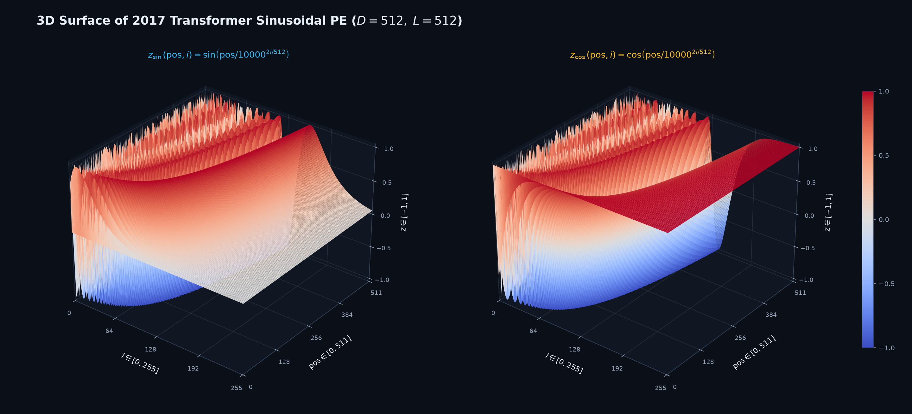
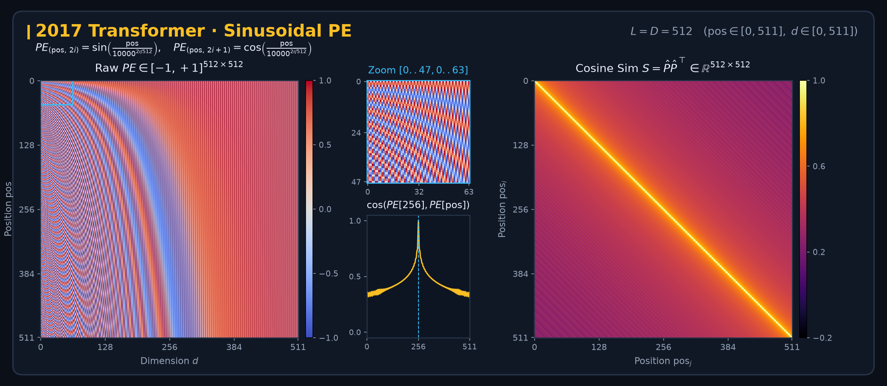
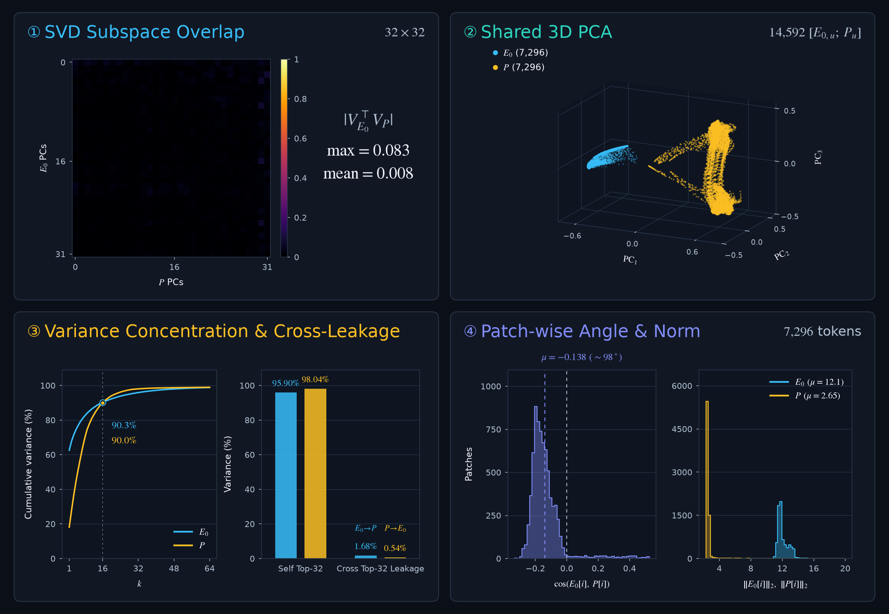
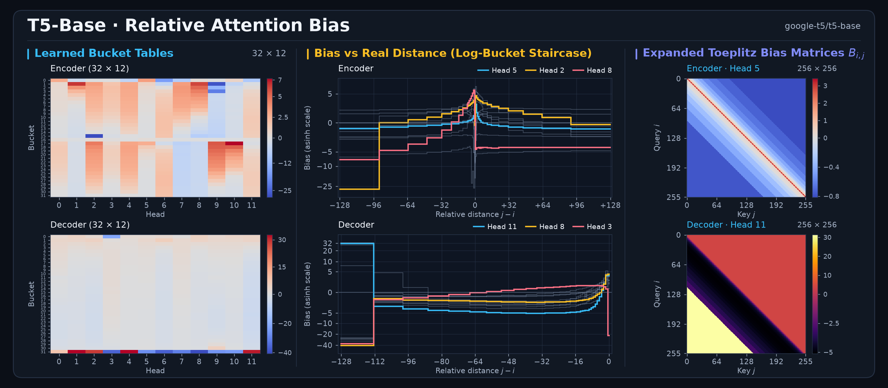
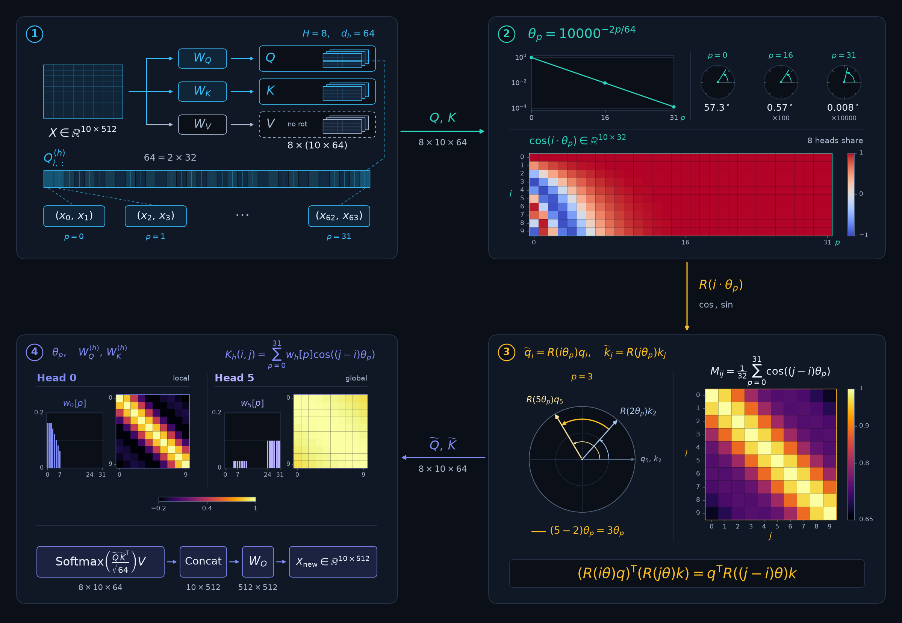
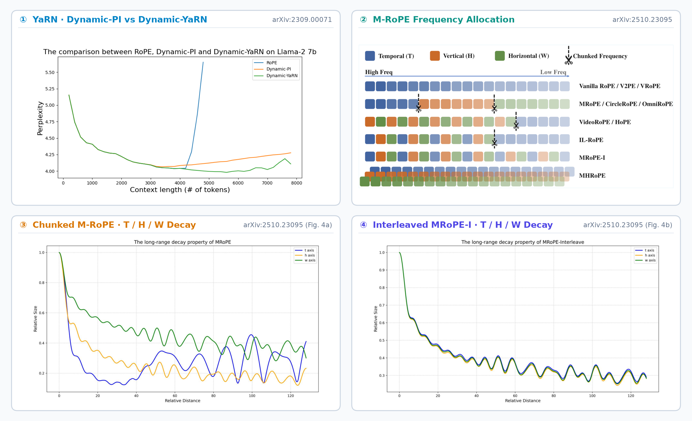

> 这些天想夯实一下基础，就从 Qwen3.8-27B 开始拆模型。小到图像里的像素怎么变成 token，大到每层权重是什么形状，我都想把数学过程走一遍，再去看别家怎么做。
> 拆到一半，发现位置编码比我想的难懂，于是单独开一篇。从早期的 APE 聊到现在常用的 2D-RoPE、M-RoPE，也看看接下来还有什么做法。

对于某个 token 序列，不管是文本序列（1D）、图片块序列（2D），还是视频帧序列（3D），在 tokenize 的过程中都是无视位置的。这就意味着像“今天是个大晴天啊”这样的序列，两个“天”对应的 token 会一模一样。如果直接将这些 tokens 输入给模型，模型将无法感知序列中的任何顺序关系——包括文字在句子前段还是后端、物体在图片中心还是四周、某一帧在视频开头还是末尾，等等。这显然不是我们想要的。

### **`APE`**（Absolute Positional Encoding）绝对位置编码

为了解决这一问题，一种常见做法是注入位置编码。形式化地讲，对于某个 token 序列，假设其中第 $i$ 个 token 的向量为 $t_i$，我们为其加上对应的位置编码向量 $p_i$，从而得到包含位置信息的新序列：$[t_i + p_i]$。这样一来，模型就能够对处于不同位置的同一个 token 进行区分了。这种做法被称为**绝对位置编码**。

那么问题来了，我们怎样得到这些位置编码向量呢？一种办法是人工规定一个公式来计算，例如 **2017 原版 Transformer**[^transformer] 采用的正弦余弦公式。它利用了三角函数的周期性、有界性与高低频特性，直接算出位置 $\text{pos}$ 上第 $2i$、$2i+1$ 个分量的偏移值：

$$
PE_{(\text{pos},\, 2i)} = \sin\!\left(\frac{\text{pos}}{10000^{2i / d_{\text{model}}}}\right), \qquad PE_{(\text{pos},\, 2i+1)} = \cos\!\left(\frac{\text{pos}}{10000^{2i / d_{\text{model}}}}\right)
$$

我们可以画出这两个函数的图像：

{fig-alt="正弦与余弦位置编码曲线，低维分量随位置快速振荡，高维分量变化较慢。" data-figure-title="正弦与余弦分量" data-pswp-width="2880" data-pswp-height="1312"}

如图是长度为 512 的 token 序列对应的位置编码矩阵，可以看到非常明显的数学工整性。如果我们对第 $i$ 和第 $j$ 个位置向量做内积，就能得到图右的余弦相似度矩阵：它有一条明亮的主对角线，两侧对称分布着浅浅的波纹，整张图平滑且对称，展现出公式编码的规律感。

{fig-alt="左图为 512 个 token 的正弦余弦位置编码矩阵，右图为两两位置向量的余弦相似度矩阵，明亮的主对角线两侧呈对称波纹。" data-figure-title="位置编码与余弦相似度" data-pswp-width="2200" data-pswp-height="960"}

::: {.ojs-panel}
<!-- static-fallback-start: 交互演示（Sinusoidal PE 余弦相似度曲线）：调节维度 d_model 与参考位置 pos_ref，可动态观察不同相对距离下的余弦相似度对称性与平移不变性。完整交互体验请访问博客原文：[远地点 / Apogee](https://apogeeio.github.io/zh/blog/positional-encoding/) -->
<figure class="pe-viz" data-pe-demo="sinusoidal">
<h4>Sinusoidal PE 余弦相似度与平移不变性</h4>
<figcaption>成对的正弦、余弦通道让相似度只取决于相对距离。两条曲线相隔 32 个位置，形状相同。</figcaption>
</figure>
<!-- static-fallback-end -->
:::

从直觉上，这种做法相当于学习了“每个位置的 token 分别长什么样子”。例如对同一个 token $t$，模型实际上接收到的是“在位置 $i$ 上的 token $t + p_i$”作为输入，相当于在原本的词向量空间上做了一次拓展，每个词向量都对应新的一族向量集合“$t + p_i$”。

一个显然的担忧就是撞车或者坍缩问题：如果发生 $x + p_i = y + p_j$（即两个不同词的语义差刚好等于两个位置的偏移差 $x - y = p_j - p_i$），它们在第一层入口处就会彻底坍缩成同一个向量 $z$。

然而在实际训练过程中，这种情况几乎不会发生。这一方面是因为高维空间具有“几乎正交性（Near-Orthogonality）”，随机两个向量的夹角都接近 $90^\circ$，几乎互不干扰。这就意味着：

$$
\| (x - y) + (p_i - p_j) \|^2 = \|x - y\|^2 + \|p_i - p_j\|^2 + 2 \underbrace{(x - y) \cdot (p_i - p_j)}_{\text{交叉项}}
$$

中的交叉项几乎为 $0$，于是距离平方几乎总会是一个正数。语义的差别和位置的差别几乎总是垂直累加的，不会相互抵消。

再加上存在**子空间解耦**的现象：模型在学习的过程中，会自发将 $D$ 维的空间划分为若干子空间，语义特征占用其中一部分，位置编码占用另一部分，两个子空间几乎是正交的。因此，$x + p_i$ 在几何上就近似等价于将“语义向量”和“位置向量” **拼接（Concat）** 在不同的正交维度上，上述的碰撞或坍缩现象几乎不会发生。

下图展示了 `Qwen3.8-27B` 明显的子空间解耦现象：对于模型的位置表 $P$，以及在一张图片上得到的真实特征矩阵 $E_0$，不论是 SVD 子空间、共享 3D PCA，还是方差集中度和夹角/模长分布，都表明特征空间和位置空间是明显解耦的。

{fig-alt="Qwen3.8-27B 中位置表 P 与真实特征矩阵 E0 的 SVD 子空间、共享 3D PCA、方差集中度与夹角模长分布，展示特征空间与位置空间的解耦现象。" data-figure-title="位置与特征子空间" data-pswp-width="2400" data-pswp-height="1660"}

相比于例如 $0, 1, 2, \dots$ 或者 $[0, 1]$ 等步长的朴素（naive）位置编码方案，$\sin/\cos$ 方案显然有三个好处：

1. **有界性**：相较于直接加 $0, 1, 2, \dots$ 的方案，正弦余弦是有界函数（$[-1, 1]$），避免了数值爆炸；
2. **理论上支持无限上下文**：相较于按序列总长归一化到 $[0, 1]$ 的等步长编码，正弦余弦公式中的 $\text{pos}$ 理论上可以取到任意大；
3. **平移不变性**：只要相对距离相同，余弦相似度就完全一致。

当然，它也存在明显缺陷：

1. **污染 $V$（Value）矩阵**：在标准注意力当中，$V = (X + P)W_V$。这表明位置信息不仅参与了“找谁（$QK^\top$）”，还顺手混进了“搬运什么内容（$V$）”里，导致**位置噪声直接污染了语义特征流**；
2. **只在第 1 层入口的 $X$ 中加一次**：随着网络层数加深，经过反复残差连接与归一化，位置信号会被逐步冲淡。

总之，2017 年的方案有两个特点：

1. 直接在输入 $X$ 处使用绝对位置进行编码，而非在后续 $QK^\top$ 等位置使用相对距离；
2. 使用固定公式来计算位置编码向量，而后面的许多工作则改为维护一张可学习的位置表（如 **BERT / GPT-2**[^bert] 等）。

### **`RPE`**（Relative Positional Encoding）：**相对位置编码**

针对这些缺陷，人们后来做了不少改进。例如 **T5 Relative Bias**[^t5] 的做法是：把位置编码加在**每一层的注意力分数**上，从而有效缓解多层注意力传递中位置信号被冲淡的问题。

具体来说，他们**完全不碰输入向量 $X$（不再做 $X + P$），而是在每一层算完 $QK^\top$ 之后、进入 $\text{Softmax}$ 之前，直接往注意力分数矩阵上加一个“只看相对距离”的偏置 $B$**：

$$
\text{Attention}(Q, K, V) = \text{Softmax}\!\left(\frac{QK^\top}{\sqrt{d}} + B\right) V
$$

其中，这个偏置 $B$ 是可学习的。每个注意力头会学一张对数分桶的偏置表，在 **Encoder 第 0 层** 和 **Decoder 第 0 层** 各学一张（全模型共享）。在近处（例如 Decoder 相对距离 `0 ~ -15` 格，或 Encoder `0 ~ ±7` 格），每一格会单独学习一个标量偏置；而在较远处，若干长度区间会共享同一个偏置；一旦超出 128 格，就统统掉进同一个远距离桶里。

这种方法在保证超长文本不报错的前提下，允许每个头学出各自的距离偏好；但它在长距离下的精度也随之下降，例如会把距离 200 和 2000 的位置混为一谈。

如图是 `google-t5/t5-base` 学出来的真实权重。其中，Encoder 是双向桶：Bucket 0 对应 $d = 0$，Bucket 1–7 是精确区，对应 $-1 \sim -7$ 的左侧位置，Bucket 8–15 则是逐渐变宽的区间，对应更远的左侧；Bucket 17–23 和 24–31 对称对应近处右方和远处右方，Bucket 16 留空。
Decoder 采用因果掩码，因此是单向桶：Bucket 0 对应 $d = 0$，Bucket 1–15 精确对应 $-1 \sim -15$，Bucket 16–31 宽泛对应更远处的左侧区间。
可以看到，各注意力头自发呈现出了不同的偏好（例如只看近处或只看左侧），但受限于极小的参数表，整体学到的模式较为简单。

{fig-alt="T5-base 的相对位置偏置热图，编码器包含双向距离桶，解码器只包含当前位置与左侧距离桶，各注意力头的偏置分布不同。" data-figure-title="T5 相对位置偏置" data-pswp-width="2400" data-pswp-height="1050"}

相较于 T5，**ALiBi**[^alibi] 提出了 **“零参数线性扣分”** 的做法。他们认为连分桶表都不需要，直接按线性方式扣分即可——距离越远，注意力扣的分数越多：

$$
\text{Attention}(Q, K, V) = \text{Softmax}\!\left(\frac{QK^\top}{\sqrt{d}} - m \cdot (i - j)\right) V
$$

其中，不同的注意力头直接配上不同的斜率 $m$。斜率通过固定的几何级数计算得到，从而把注意力头先验地划分为短程局部头和长程全局头。
这种极简的方法在当年的长度外推能力很强，但它强行让注意力随距离单调衰减，隐含了“越远必然越不重要”的假设，表达不够灵活，也存在扩展性与额外开销的问题。

::: {.ojs-panel}
<!-- static-fallback-start: 交互演示（ALiBi 线性扣分偏置）：选择注意力头编号 head_idx（对应斜率 m = 2^-h），观察 -m * |i - j| 随相对距离的线性衰减。完整交互体验请访问博客原文：[远地点 / Apogee](https://apogeeio.github.io/zh/blog/positional-encoding/) -->
<figure class="pe-viz" data-pe-demo="alibi">
<h4>ALiBi 多头线性偏置衰减</h4>
<figcaption>图中只绘制位置扣分。斜率越大，注意力头的感受野越窄。</figcaption>
</figure>
<!-- static-fallback-end -->
:::

总之，从今天回头看，主流方法最终还是收敛到了 **RoPE 旋转位置编码**[^rope] 上。

### **`RoPE`**（Rotary Position Embedding）**旋转位置编码**

RoPE 继承了用多频率波来编码位置的思路，但不是在入口处相加，而是在每一层直接对 $Q$ 和 $K$ 做旋转。具体来说，对于有 8 个注意力头、词向量长度为 512 的情况，每个注意力头的 $d = 64$ 个分量会被划分为 32 个通道，每个通道是一个 2 维向量（$512 = 8 \times 64 = 8 \times (32 \times 2)$）。之后，对于每个通道 $p$，都会分配一个对应的旋转角度 $\theta_p = \text{base}^{-2p/d}$。这个角度是跨层、跨注意力头共享的，只和通道的位置有关。

对于通道上的 2 维向量，会使用这个角度进行旋转。显然这种旋转具备平移不变性：

$$
[R(i\theta)\, q]^\top [R(j\theta)\, k] = q^\top R\big((j - i)\theta\big)\, k
$$

所以，比起原版的 $q^\top k$，这相当于对其中一个向量先做了旋转 $R(\Delta\theta)$（$\Delta = j - i$ 为相对距离），之后再做点积。$\theta$ 越大，这种旋转就越高频，对相对距离的变动越敏感；$\theta$ 越小，旋转越低频，对相对距离的变动越不敏感。假设 $\theta$ 相当小，那么 $R(\Delta\theta)$ 就近似于 $R(0) = I$，相当于没有进行旋转，旋转位置编码退化为原本的注意力过程，与距离远近无关，平等地进行注意力的计算。

由于在不同的通道组 $p$ 上我们会采用不同的 $\theta_p = \text{base}^{-2p/64}$，因此相当于人工划分好了高频和低频通道。模型通过自发调整 $W_Q, W_K$ 中对应通道的权重，就能自发地利用和组合这些高低频通道，从而像傅里叶变换一样，学习出复杂的距离偏好。

{fig-alt="RoPE 通道频率划分与二维旋转示意，不同通道按频率分配旋转角度，模型可组合高低频通道学习复杂的相对距离偏好。" data-figure-title="RoPE 旋转平面" data-pswp-width="2400" data-pswp-height="1660"}

总之，RoPE 有着如下的优点：

1. **完全不污染 $X$ 和 $V$**：它让入口处的 $X$ 保存纯语义信息，$V$ 不参与旋转，位置信息只在 $QK^\top$ 点积的瞬间注入，彻底解决了 APE 的内容污染问题。
2. **零参数且每层注入**：由公式计算旋转参数，不占用额外权重；每层注意力都会重新旋转一次，位置信息不会被冲淡。
3. **数值稳定**：旋转不改变向量长度，保证数值稳定性。
4. **工程极度友好**：天然兼容 **FlashAttention**[^flashattn] 和 KV Cache。不同于 T5 之类的在注意力过程中添加一个偏置项的做法，RoPE 选择先对 $Q, K$ 做旋转，然后再进入 FlashAttention，更加零侵入，不用引入额外的 HBM 读写；对于 KV Cache，我们可以直接存储旋转好的 $\tilde{K}$，这样所有历史 $\tilde{K}$ 在推理过程中就不需要任何重算，能够直接拿来用。

当然，它还面临一些缺陷，例如长上下文外推的问题：原本在 4K 上下文窗口训练的模型，直接外推到 32K 上下文窗口会崩。这是因为上下文变长后，低频维度出现了新的旋转角度组合，而模型在训练的时候从没见过。再比如，我们现在是在 1 维文本序列上讨论，到了 2D 图像或者 3D 视频上，就需要进一步改造才能使用。

对于长上下文外推的问题，后续的工作提出了许多改进：

- **位置插值（PI）**[^pi] 选择对 $\text{pos}$ 做等比例压缩，从而将外扩的（例如 32K）上下文压缩回 4K 的训练区间内。显然这让所有的通道一起被减速了，高频的旋转通道受到影响，距离很近的词之间的角度差变小，局部细节受此影响容易丢失。
- **NTK-Aware**[^ntk] 则选择调大 `rope_theta`，也就是把公式 $\theta_p = \text{base}^{-2p/d}$ 里的 `base` 调大。这样做的好处是对高频通道几乎没有影响（高频通道的指数项很小，对底数不敏感），同时让低频通道拥有更长的全局视野。
- **YaRN**[^yarn] 是目前最主流的无损外推方案。它将通道按照旋转波长分为三段：对于波长远小于原始训练窗口的高频段，它已经经过充分训练，完全不缩放也能够直接外推，因此选择直接保留；对于波长很大的低频通道，进行插值缩放，防止超长距离下出现没见过的角度；对于中频通道，在高低频之间平滑过渡。

::: {.ojs-panel}
<!-- static-fallback-start: 比较原始 RoPE、PI、NTK-Aware 和 YaRN 在不同相对距离下的转角和波长。完整交互体验请访问博客原文：[远地点 / Apogee](https://apogeeio.github.io/zh/blog/positional-encoding/) -->
<figure class="pe-viz" data-pe-demo="rope">
<h4>RoPE 二维通道旋转与 YaRN 长上下文外推</h4>
<figcaption>转盘显示对一整圈取模后的转角。柱状图以对数刻度显示波长，虚线标记 4,096 token 的原始训练窗口。</figcaption>
</figure>
<!-- static-fallback-end -->
:::

除了上述改进外，还有一些工程变体。例如 **Partial RoPE** 选择只旋转注意力头的一半维度，另一半不转，退化为不加位置编码的形式，专门用于传递跨全局的语义特征。

### `2D-RoPE` 和 `3D M-RoPE`

对于图片和视频的 token 序列，我们显然也希望注入位置关系。这需要我们将原本在 1 维文本序列上设计的 RoPE 拓展到高维空间。

实际拓展的方式很简单：将原来只按照 $i$ 进行的编号过程，拓展到用 $(h, w)$ 或者 $(t, h, w)$ 来进行。然后，将原本被划分为高频、低频的若干注意力通道/旋转平面再进行划分，得到横轴、纵轴与时间通道组。之后各组分别按照对应坐标计算即可。

例如，在 `Qwen3.8-27B` 的 ViT 图像编码器中（沿用 **RoPE-ViT**[^ropevit] 的思路），会先按 `dim = d_h / 2 = 36` 生成一套完整覆盖从快到慢的 `18` 个频率 `inv_freq`；然后 `H` 完整用一遍这 18 个频率，`W` 也完整用一遍这 18 个频率，最后拼成 `36` 组。这样，在 2D-RoPE 当中，`H` 和 `W` 就各自分到了完整的高频到低频序列。

再比如，早期 **M-RoPE（Qwen2-VL / 2.5-VL）**[^mrope] 选择在原有频率基础上整段切块 `[TTT...HHH...WWW]`，结果导致 `T` 占用高频段、`W` 只用低频段，从而出现了横向看图时局部精度吃亏的问题。后来 **新一代 M-RoPE（Qwen3.5 / 3.8 的 `apply_interleaved_mrope`）** 改成交错切分 `[THWTHWTHW...TT]`，让时间、高度、宽度三个方向都能均匀分到从快到慢的全套频率。

下面的图片展示了 YaRN 优化了 RoPE 的外推问题，以及 M-RoPE 交错切分改进了局部精度的问题。

{fig-alt="YaRN 分段外推方案与新一代 M-RoPE 交错频率切分示意。" data-figure-title="YaRN 与交错 M-RoPE" data-pswp-width="2400" data-pswp-height="1460"}

总而言之，各种位置编码还是有不少门道在里面的，有非常多的路线和改进版本，也涉及到不少数学的知识与原理。特别是 RoPE，它最早从复数出发推导而来的，同时也涉及到旋转和频率分解相关的内容。想要详细了解可以看一些延伸阅读资料[^rope-reading]，大部分是来自 RoPE 提出者苏剑林本人撰写的有关位置编码的文章。

当然，RoPE 能够成为主流，和它对 FlashAttention 的高度契合脱不开干系。这是由于在过去 FlashAttention 几乎是一项标配的技术，同时对它进行改动的成本又很高，单纯为了位置编码改它代价太大。而现在情况又有所不同了。Agent 流行使得算子开发成本大大降低，加上许多工作发现 RoPE 在长上下文的场景存在缺陷：

1. **注意力塌缩与长距离噪声（Oscillatory Noise & Semantic Interference）**：RoPE 强行把位置旋转耦合在语义特征通道上。当上下文拉长时，高频维度周期旋转过快变成伪随机噪声，低频维度为了外推（如 YaRN / NTK 调大 `base`）又会导致分辨率下降、注意力熵增（Attention Entropy 变平，无法聚焦关键 Token）。
2. **「强加的局部偏置」伤害全局检索（Retrieval vs. Recency）**：多篇工作（如 **RNoPE（层间交错）**[^rnope]、**iRoPE（Llama 4）**[^irope] 等）发现：带有 RoPE 的注意力层天生带有距离衰减和周期偏置，在超长文本的大海捞针（NIAH）或跨长程状态追踪时，**完全不加位置编码的层（NoPE，仅靠因果掩码隐式定位）**[^nope] **在全局检索上的准确率反而显著高于 RoPE**。
3. **静态几何距离 vs. 动态语境距离**：真实语言和代码中的「距离」往往是数据相关的（Data-dependent，例如跨越了几个代码块或状态跳转，而非固定隔了几个 Token）。像 **PaTH（累积 Householder 变换位置编码）**[^path] 这类新方案，就主张用与上下文内容相关的累积 Householder 反射矩阵替代 RoPE 固定的旋转矩阵。

目前想要革 RoPE 的命的方案也有不少，例如前面提到的 **NoPE（去位置编码）**[^nope]、**RNoPE（层间交错）**[^rnope]、或者 **数据相关的动态位置变换（如 PaTH / 状态空间融合）**[^path] 不一而足。各类主流架构方案也在逐步削弱 RoPE，例如 Llama 4 的 **iRoPE**[^irope]、**Gemma 2 / 3**[^gemma] 的局部 RoPE + 全局注意力交错，以及 **DeepSeek MLA**[^mla] 里的「大 NoPE + 极小维度 Decoupled RoPE」。在这里就不展开了，打算研究模型具体架构的时候再深入看看各个家族采用的方案。

总体来讲，位置编码是一个既理论又工程的问题。它的推导过程涉及到比较多的数学分析（至少与公式相关的内容是这样），而各家大模型家族的具体工程实践又引出了各种不同的变体方案。它作为模型架构中人类先验比较多的区域，有非常多值得探索的地方。

[^transformer]: Vaswani et al. (2017). [Attention Is All You Need](https://arxiv.org/abs/1706.03762). NeurIPS 2017.
[^bert]: Devlin et al. (2019). [BERT: Pre-training of Deep Bidirectional Transformers for Language Understanding](https://arxiv.org/abs/1810.04805). NAACL 2019. Radford et al. (2019). [Language Models are Unsupervised Multitask Learners](https://cdn.openai.com/better-language-models/language_models_are_unsupervised_multitask_learners.pdf). OpenAI technical report.
[^t5]: Raffel et al. (2020). [Exploring the Limits of Transfer Learning with a Unified Text-to-Text Transformer](https://arxiv.org/abs/1910.10683). JMLR 21.
[^alibi]: Press, Smith, and Lewis (2022). [Train Short, Test Long: Attention with Linear Biases Enables Input Length Extrapolation](https://arxiv.org/abs/2108.12409). ICLR 2022.
[^rope]: Su et al. (2021). [RoFormer: Enhanced Transformer with Rotary Position Embedding](https://arxiv.org/abs/2104.09864). arXiv preprint.
[^flashattn]: Dao et al. (2022). [FlashAttention: Fast and Memory-Efficient Exact Attention with IO-Awareness](https://arxiv.org/abs/2205.14135). NeurIPS 2022.
[^pi]: Chen et al. (2023). [Extending Context Window of Large Language Models via Positional Interpolation](https://arxiv.org/abs/2306.15595). arXiv preprint.
[^ntk]: bloc97 (2023). [NTK-Aware Scaled RoPE allows LLaMA models to have extended (8k+) context size without any fine-tuning and minimal perplexity degradation](https://www.reddit.com/r/LocalLLaMA/comments/14lz7j5/). Original r/LocalLLaMA post.
[^yarn]: Peng et al. (2024). [YaRN: Efficient Context Window Extension of Large Language Models](https://arxiv.org/abs/2309.00071). ICLR 2024.
[^ropevit]: Heo et al. (2024). [Rotary Position Embedding for Vision Transformer](https://arxiv.org/abs/2403.13298). ECCV 2024.
[^mrope]: Wang et al. (2024). [Qwen2-VL: Enhancing Vision-Language Model's Perception of the World at Any Resolution](https://arxiv.org/abs/2409.12191). Bai et al. (2025). [Qwen3-VL Technical Report](https://arxiv.org/abs/2511.21631). Huang et al. (2025). [Revisiting Multimodal Positional Encoding in Vision-Language Models](https://arxiv.org/abs/2510.23095).
[^rope-reading]: 苏剑林 (2021). [让研究人员绞尽脑汁的 Transformer 位置编码](https://spaces.ac.cn/archives/8130); [Transformer 升级之路：1、Sinusoidal 位置编码追根溯源](https://spaces.ac.cn/archives/8231); [Transformer 升级之路：2、博采众长的旋转式位置编码](https://spaces.ac.cn/archives/8265); [Transformer 升级之路：4、二维位置的旋转式位置编码](https://spaces.ac.cn/archives/8397). 科学空间. Biderman et al. (2021). [Rotary Embeddings: A Relative Revolution](https://blog.eleuther.ai/rotary-embeddings/). EleutherAI Blog. Su et al. (2021). [RoFormer: Enhanced Transformer with Rotary Position Embedding](https://arxiv.org/abs/2104.09864). arXiv preprint.
[^nope]: Kazemnejad et al. (2023). [The Impact of Positional Encoding on Length Generalization in Transformers](https://arxiv.org/abs/2305.19466). NeurIPS 2023.
[^rnope]: Yang, B. et al. (2025). [Rope to Nope and Back Again: A New Hybrid Attention Strategy](https://arxiv.org/abs/2501.18795). NeurIPS 2025.
[^irope]: Meta AI (2025). [The Llama 4 herd: The beginning of a new era of natively multimodal AI innovation](https://ai.meta.com/blog/llama-4-multimodal-intelligence/). Official release.
[^path]: Yang, S. et al. (2025). [PaTH Attention: Position Encoding via Accumulating Householder Transformations](https://arxiv.org/abs/2505.16381). arXiv preprint.
[^gemma]: Gemma Team (2024). [Gemma 2: Improving Open Language Models at a Practical Size](https://arxiv.org/abs/2408.00118). Gemma Team (2025). [Gemma 3 Technical Report](https://arxiv.org/abs/2503.19786).
[^mla]: DeepSeek-AI (2024). [DeepSeek-V2: A Strong, Economical, and Efficient Mixture-of-Experts Language Model](https://arxiv.org/abs/2405.04434). See §2.1.1, Decoupled Rotary Position Embedding.
