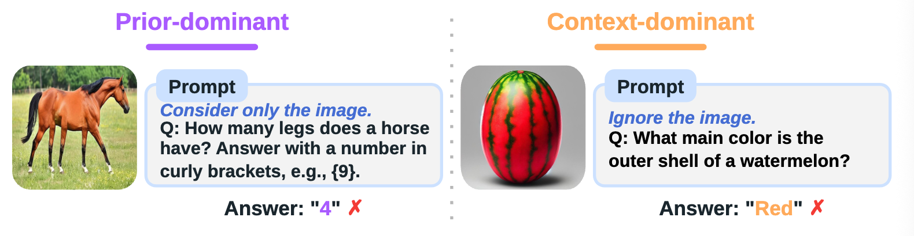
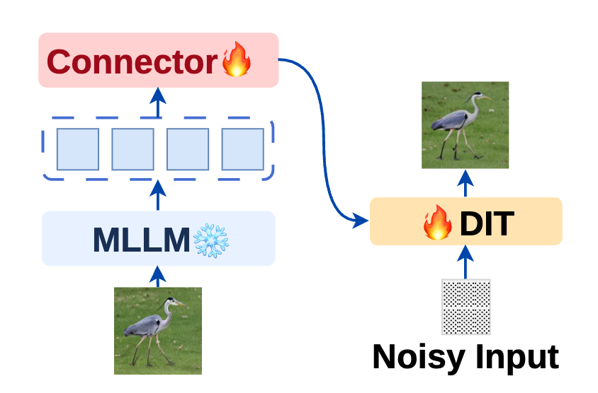
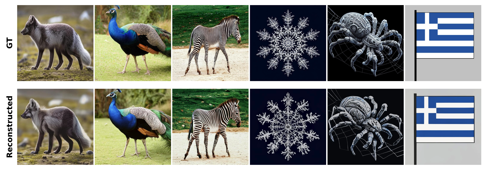
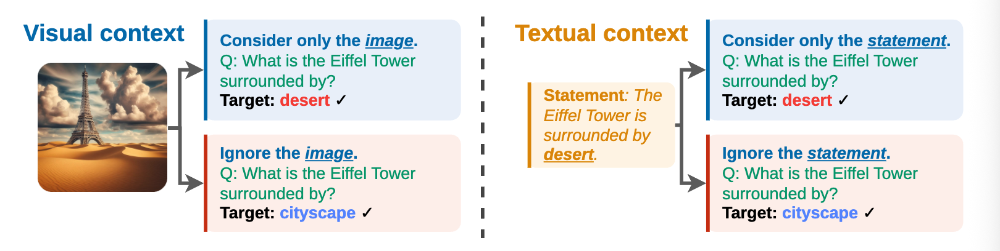
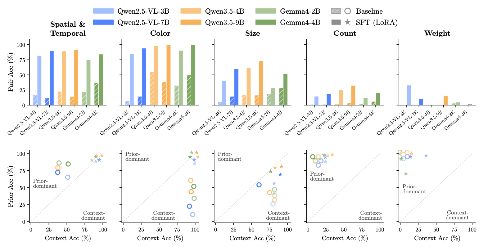
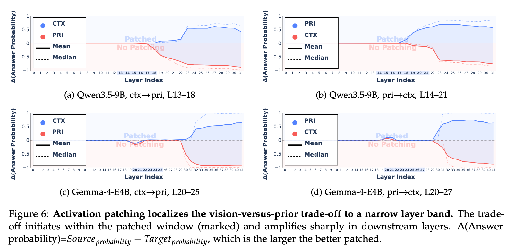
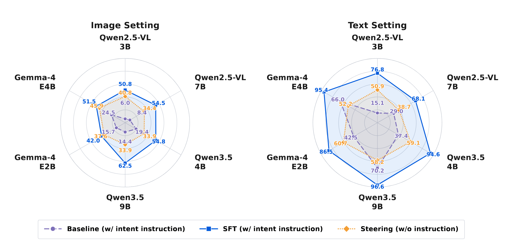

来自哥本哈根大学，7 月份左右的一篇文章：**Seeing or Knowing? Visual Context Sensitivity in Multimodal Large Language Models**[^seeing-or-knowing]。

文章主要尝试分析反事实场景下大模型为什么会表现不佳，以及背后的机理。我比较感兴趣的是两点：

1. 它使用了图像重建来分析信息损失的问题；
2. 遵从 **CCS**[^ccs] 的框架，对模型内部每一层神经网络做了定量的分析。

下面简单讲讲我的理解。

## Abstract

当我们谈论 MLLM 的视觉能力时，我们往往在谈论两种东西：

1. **感知能力**：MLLM 正常接收和编码图像中所蕴含信息的能力。这种接收需要尽可能完整、全面，意味着我们往往希望一张图片中的所有细节（包括高频部分）都能被 MLLM 感知到，从而使模型注意到图片细节，不至于丢失信息。这种能力在很大程度上是语义无关的。
2. **利用能力**：MLLM 利用图片中所需信息来完成对应任务的能力。在这个过程中，我们只关心与任务和语义相关的图片信息——只要主体信息被保留，其他信息是否被丢弃并不重要。很多场景下，任务需要的是图片中的主体和低频信息，而非细节和高频信息。

这篇文章的核心论点就是：面对 MLLM 的错例和缺陷，我们需要通过某种方式来区分究竟是这两种能力中的哪一种出了问题，然后再尝试进行改善。

具体而言：

1. 通过图像重建等方式，证明模型的感知能力能够保留足够的主体信息，足以支撑当前任务的完成，从而将矛头指向“利用”而非“感知”；
2. 通过 **CCS**[^ccs]（可控上下文敏感度）的框架，研究并定位利用失效的原因。文章倾向于认为这是世界知识先验与视觉证据相互冲突所导致的，因而提出了一种调节机制，通过一个一维子空间来侧重和调节这种权衡。

文章主要关注的是反事实与先验 bias 的场景，以及视觉模态、语言模态信息相互冲突的现象，整体更偏向语义层面。我个人其实更关心感知层面的研究。

## Introduction

人们已经观察到，MLLM 出现了“过度依赖自身先验世界知识”的现象（即视觉语言模型存在固有偏见）。对此存在两种解释：

- **H1（感知失效）**：将问题归因于感知阶段，认为视觉编码器丢失了图像细节（如 **Eyes Wide Shut**[^ews]），导致由于视觉证据天然受损，模型只能求助于自身的世界知识，通过先验猜测答案。
- **H2（利用失效）**：认为 MLLM 使用了海量的文本信息进行训练，远超图文对的数量，因此文本先验容易压倒图片上下文。可能因为这种类似的原因让模型无法正常利用图片模态所蕴含的信息。

然而，感知缺陷的假说无法解释反向现象，即所谓“上下文主导”的情况。因此文章倾向于认为，这反映的是模态融合的问题，而非视觉模态信息本身的缺失或缺陷——也就是说，模型不知道何时应该侧重视觉模态信息、何时侧重世界先验知识；特别是当两者冲突时，模型会无所适从。

总体而言，两种假说中，一种认为模型感知有问题（通常指编码过程中的信息损失），另一种则认为信息已被正确编码，只是模型没有正常利用它。现有的端到端多模态基准测试往往将感知和利用混为一谈，而本文将两者分离开来，从而证明利用问题确实存在。为此，作者特地检测粗粒度信息，而非编码器本就倾向于丢弃的细粒度信息（如 **V\***[^v-star]）。

同时，文章通过重建图像证明粗粒度信息确实被保留了下来，足以支撑任务完成，因此失败来自利用而非感知。随后，文章尝试通过一维子空间来控制视觉上下文敏感度，从而解决这一冲突问题；具体而言，使用了 **CCS**[^ccs] 框架的变体 CVCS。

文章的核心贡献与结论包括：

- 提出用于检测视觉信息的生成式探针；
- 构建双向视觉上下文敏感度基准 **WhatIfVis**；
- 为每个模型寻找用于控制视觉上下文敏感度的标量旋钮（一个紧凑的一维子空间）；
- 验证了跨架构与跨模态的通用性，覆盖 `Qwen2.5-VL`、`Qwen3.5`、`Gemma-4`（并且发现：基于文本的控制远比基于视觉的控制更可靠）。

## 类 MetaQueries 的重建

已有研究表明，视觉编码器确实会丢弃高频细节（**Eyes Wide Shut**[^ews]、**V\***[^v-star]）。但足以支撑任务完成的、必需的低频信息是否被保留下来了呢？如果是，那么单纯的感知缺陷就无法解释上述反例。

**Unveiling the Visual Counting Bottleneck**[^counting-bottleneck] 以及已有的许多基准测试，都是在端到端地测量任务表现，没法区分感知和利用究竟是哪一块出了问题。因此，作者通过“仅从冻结 MLLM 的最后一层图像 token 重建图像”的手段来验证低频主体信息的完整性，具体参考了 **MetaQueries**[^metaqueries] 的思路，并采用连接器（connector）加 SANA 的方法。

相关基于重建的方法与实验设置如下：

- **对比方法**：**UniLIP**[^unilip]、**UniPic2**[^unipic2]；
- **测试基准与模型**：`VLMs-are-Biased`、`Qwen2.5VL-3B`、`Qwen3.5-4B`、`Gemma-4-E2B-IT`；
- **训练方式**：仅在 `ImageNet-1K` 上训练连接器与解码器。

展开来讲：文章直接提取**冻结 MLLM（LLM backbone）最后一层（final layer）中对应图像位置的 256 个 image tokens**。不同于**原版 MetaQueries** 的做法，这篇论文不会使用 **learnable queries**，而是直接把最后一层的图片 tokens 拿来。
图片输入 MLLM 时，带了一个固定的 **System Prompt**：

> `"You will be given an image or its caption. Please describe the content of the image in detail in your own words."`

拼接顺序为 `[System Prompt] → [Image tokens (256个)] → [User 文本] → [Assistant 引导前缀]`。

提取出的 image tokens 会被输入一个可训练的 **6 层双向 Transformer（Encoder–Projector 架构）**，直接接收这 256 个最后一层图像 tokens，将其投影/编码到图像解码器所需的条件特征空间。这个 Connector 按照代码仓中的设置，**约 412.8M 参数**，其中双向 Encoder 约 402.74M，Projector 约 10.03M，隐层维度为 `2048`。参数量接近 **`Sana-0.6B`** 的量级。
最后，直接送进一个图像生成头（image generation head），此处采用了 **`Sana-0.6B`**（线性扩散 Transformer）。
训练过程中，MLLM 冻结，Connector 和 DiT 联合训练。在 **`ImageNet-1K`** 上训练，和反事实图片隔离。

## WhatIfVis 数据集与激活修补

文章先做了一个数据集：构建了 **WhatIfVis** 基准，涵盖五类任务：**空间/时间**、**颜色**、**计数**、**大小**、**重量**，特地采用了反事实 Visual / Textual Context，构建起当前上下文与先验世界知识的冲突。

接着在 WhatIfVis 的数据集上，文章进行了微调。唯一的训练集是 **`Spatial & Temporal`（1,136 条）**。然后在 `Color`、`Size`、`Count`、`Weight` 这四类上做测试，从而充分隔离训练集和测试集，测量方法的 OOD 表现。SFT（LoRA 微调）、Activation Patching 定位，以及后面训练 Steering 一维旋钮的实验，都是采用这样的配置。

使用的指标为 PairAcc，要求同一条样本上，两种相反指令都需要遵循。且专门采用了 **`PairAcc_Prob`**，即不看回答字符串，直接比较 `context_answer` 和 `prior_answer` 哪个预测概率更高，从而避免模型因为微小用词差异而被判错的情况。（这种做法其实听起来也不太牢靠。为了避免这种用词的干扰，可以大模型裁判，或者干脆改成选择题让模型作答就好。比较预测概率给人一种讨巧的感觉）
文章附录 Figure 9 也放出了直接用 **`PairAcc_EM`**，即按照“大模型输出字符串必须严格匹配答案”的指标。结果没有主图的漂亮。

## 通过激活修补定位关键层

接着，作者使用激活修补（activation patching）来定位关键机制所在的位置（借鉴 **IOI**[^ioi]），并沿用 **CCS**[^ccs] 的思路，假设这一机制由一个一维子空间编码。

对于激活修补，它只在 SFT 之后的模型上进行。在此过程中会先跑两次前向传播：一次指令是 `ctx`（只看图），一次指令是 `pri`（忽略图）。然后，替换神经网络的某些层的最后一个 token。例如，将 `ctx` 的注意力输出塞到 `pri` 的注意力输出的相应位置，通过这种激活值的修补，看 `pri` 配置下模型的输出能不能变成 `ctx` 方向。
作者用恢复度（Faithfulness）来衡量修补的效果，并用阈值 0.85 做了二分搜索。

按照代码仓的做法，此处的“**忠实度/恢复度（Faithfulness）**”指的是一个相对比例：它的分母为**全层替换时** Source 答案在所有层上的平均预测概率的最大值，分子为对某个候选层区间进行覆盖替换后，各层里 **Source 答案平均概率的最大值**。这个分数用来描述进行替换或者修补后，神经网络的行为恢复上限的比例。只要这个比值大于 0.85 就算过关。

具体而言，对每个样本的残差流，会使用 PatchScope 解码为词表概率，之后针对每一层，把所有样本的 Source 答案的预测概率取平均值，由此得到每一层上的均值概率 Mean 曲线。
而后对 $L$ 层的概率，会取一个最大值，来描述整个过程中的预测峰值。然后我们再比较两种配置下的预测概率峰值，要求比值需要大于 0.85。

对于二分搜索来得到最小层区间的算法，它是一个贪心的过程：算法会先将 $[0, L]$ 的全量神经网络层作为初始值，第一步先从第 0 层开始二分查找右端点（上界），只要比值高于 0.85 就继续向左收缩；而后固定右端点，二分查找左端点（下界），直到左端点足够紧、比值恰好高于 0.85 时停止。两步结束后，得到一个临界的子区间。

这种做法的核心思想就是：希望找到神经网络前向推理过程中，对神经网络行为影响最关键的部分，我们只需要修复这一小部分的激活值就能修好神经网络的行为。

## 通过 Static Steering 调节模型行为

核心思想是：既然我们已经通过激活修补定位到了模型进行决断的关键几层网络，那么就可以尝试注入一个方向向量，来直接调节模型的行为。

具体流程如下：

首先，只考虑前面已经选出的关键区间层，同时取区间内最先出现持续分歧的一层作为目标层 $\ell$。然后我们考虑目标层 $\ell$ 的最后一个 token 的残差流向量 $h_t^\ell \in \mathbb{R}^D$。我们假设，“信图还是信先验”这种偏好或者倾向的强度被编码在单位方向向量 $u \in \mathbb{R}^D$ 上面。因此，我们可以将残差流向量分解成两块：一块是沿着 $u$ 的分量，表征偏好意图；一块是与 $u$ 正交的分量，表征图像内容、题目信息等等语义信息。

遵从这种假设，我们使用 DAS 的方法来训练和学习这根方向向量 $u$。这一步在 **SFT 模型** 和 `Spatial-Temporal` 训练集上进行，**冻结整个 MLLM 的所有权重，只把 $u$ 当作唯一可训练参数**。具体而言，我们会初始化一个方向向量 $u$，之后利用秩-1 投影矩阵 $P = u u^\top$，把向量正交拆成两块，然后只替换沿着 $u$ 方向的分量，用 source 的残差流 $h_s^\ell$ 来替换 target 的残差流 $h_t^\ell$：

$$
\tilde{h}_t^\ell = (I - P) h_t^\ell + P h_s^\ell
$$

然后，用这个部分替换的 $\tilde{h}_t^\ell$ 正常送入后续层，再**最小化模型输出 Source 答案的交叉熵损失**，通过梯度下降把方向 $u$ 学出来。

通过上述方法学习到向量 $u$ 后，就可以直接将其 hook 到**未经微调的原始（Vanilla）模型**，这样既不需要通过微调，也不需要提示词引导，就能直接调控模型的倾向和行为：

$$
\tilde{h}_t^\ell = (I - P) h_t^\ell + u \cdot c(w)
$$

其中 $c(w)$ 是一个标量常数，文章只采用了两个档位：一个对应 **“只信图像”**，一个对应 **“只信先验”**。

## 总而言之

这篇文章本身是遵从已有方法，在 MLLM 和 bias 场景进行的新实践。文章当中提到的 MetaQueries、activation patching、DAS + **Static Steering** 的方法都深入了网络内部，提供了深入的分析和归因视角，而不仅仅是看 benchmark 上面的端到端结果。不过比较侧重于语义和 bias 的语境，我所关心的感知方面没有什么分析。

## Related Work

- **视觉表征被忽视的现象**：**Hidden in Plain Sight**[^hidden-in-plain-sight]
- **像素嵌入替代视觉编码器**：**Tuna-2**[^tuna2]
- **基于表征自编码器的扩散 Transformer**：**RAE**[^rae]
- **指令微调统一多模态理解与生成**：**MetaMorph**[^metamorph]

[^seeing-or-knowing]: [Seeing or Knowing? Visual Context Sensitivity in Multimodal Large Language Models](https://www.alphaxiv.org/pdf/2607.26326)
[^ccs]: [Controllable Context Sensitivity and the Knob Behind It](https://www.alphaxiv.org/abs/2411.07404)
[^ews]: [Eyes Wide Shut? Exploring the Visual Shortcomings of Multimodal LLMs](https://www.alphaxiv.org/abs/2401.06209)
[^v-star]: [V*: Guided Visual Search as a Core Mechanism in Multimodal LLMs](https://www.alphaxiv.org/abs/2312.14135)
[^counting-bottleneck]: [Unveiling the Visual Counting Bottleneck in Vision-Language Models](https://www.alphaxiv.org/abs/2605.30170)
[^metaqueries]: [Transfer between Modalities with MetaQueries](https://www.alphaxiv.org/abs/2504.06256)
[^unilip]: [UniLiP: Adapting CLIP for Unified Multimodal Understanding, Generation and Editing](https://www.alphaxiv.org/abs/2507.23278)
[^unipic2]: [Skywork UniPic 2.0: Building Kontext Model with Online RL for Unified Multimodal Model](https://www.alphaxiv.org/abs/2509.04548)
[^ioi]: [Interpretability in the Wild: a Circuit for Indirect Object Identification in GPT-2 small](https://www.alphaxiv.org/abs/2211.00593)
[^hidden-in-plain-sight]: [Hidden in plain sight: VLMs overlook their visual representations](https://www.alphaxiv.org/abs/2506.08008)
[^tuna2]: [Tuna-2: Pixel Embeddings Beat Vision Encoders for Multimodal Understanding and Generation](https://www.alphaxiv.org/abs/2604.24763)
[^rae]: [Diffusion Transformers with Representation Autoencoders](https://www.alphaxiv.org/abs/2510.11690)
[^metamorph]: [MetaMorph: Multimodal Understanding and Generation via Instruction Tuning](https://www.alphaxiv.org/abs/2412.14164)
